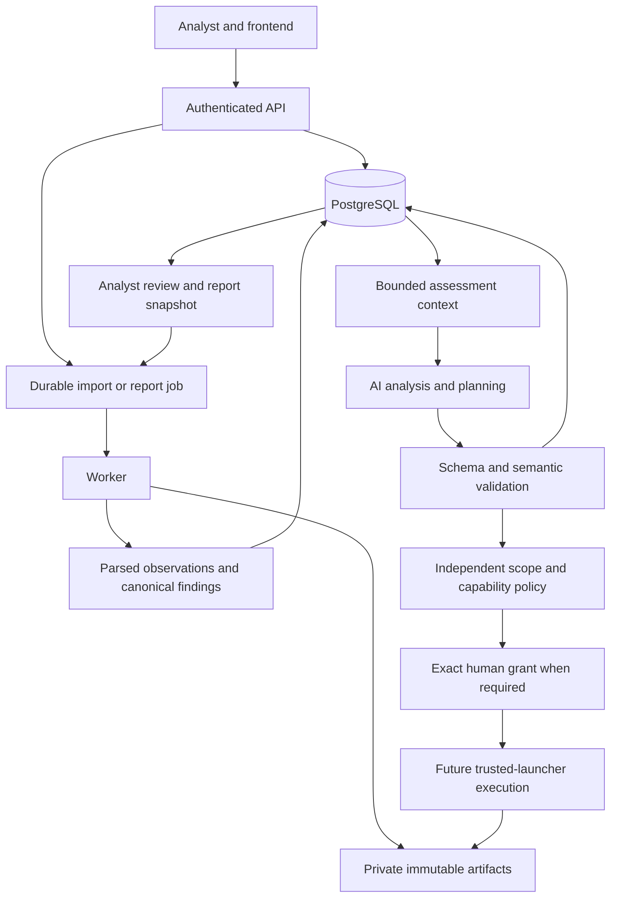

# Reknyx Cybersecurity Assessment Architecture

This document describes the platform and its security responsibilities. The frontend has explicit synthetic preview and authenticated API modes; persistence, evidence, import and reporting paths are implemented and locally tested. Import/report worker and draft PDF reporting are implemented; provider and scanner execution modules below remain implementation targets.

## Application shape

Use the existing Next.js/React/TypeScript/Tailwind frontend with HTTP polling. Add a FastAPI modular monolith, PostgreSQL, a separate Python worker from the same package, and private immutable artifact storage. Use SQLAlchemy/Alembic for persistence and migrations, and bounded HTML/PDF rendering for reports. Pin backend/runtime versions during implementation.

PostgreSQL owns assessments, scope revisions, conversations, analysis/decision records, approvals, jobs/attempts, observations/findings, reviews, audit and artifact manifests. The browser and model context are projections of that state. Import and report jobs share worker infrastructure; no separate report queue, broker, distributed agent runtime, or workflow engine is required initially.

The live branch stays disabled until authorization, capability, network enforcement, final start checks, and recovery evidence exist. An AI proposal or approval record does not establish scanner execution.

## How AI agents analyze evidence

The `security_analysis/` package provides the assessment assistant's evidence analysis and assessment planning responsibilities. Its `evidence_context.py`, `evidence_analysis.py`, `assessment_planning.py` and `output_validation.py` stages use bounded `model_providers/` and versioned `prompts/`. These stages run inside the same application; they are not independent infrastructure agents.

`assessments/` owns scope and conversation state. `scope_control/` independently enforces scope, capability, approval and dispatch rules. `scanner_integrations/` owns native format parsing and later fixed scan profiles; `orchestration/` runs the worker's durable jobs. `evidence/` preserves immutable source bytes, `findings/` owns canonical correlation/risk/review, and `reporting/` renders frozen assessment snapshots. Shared database/authentication/audit support belongs in `infrastructure/`.

| Stage | Inputs | Outputs and constraints |
| --- | --- | --- |
| Context assembly | Authorized assessment/scope revision, bounded conversation, normalized observations, memberships, previous decisions and remaining budget | Minimal permitted evidence with stable IDs; no foreign-assessment content or unsupported raw data transmission |
| Evidence analysis | Source observations and known/unknown asset/service context | Source-grounded hypotheses, conflicts, uncertainty and review questions; observations remain unchanged |
| Next-action planning | Analysis, previous attempts, implemented profile catalog and budgets | At most one typed next action with rationale/evidence IDs, or ask/stop/inconclusive; no shell/argv or authority fields |
| Independent validation | Model output plus current canonical state | Schema/reference/ownership/revision/precondition/budget checks; reject fabricated evidence, CVEs and unsupported actions |
| Policy and human review | Validated proposal and exact scope/capability state | Permit/require approval/deny; an approval cannot override a deny or unavailable capability |

Appending a message only persists it. Inference requires an explicit planning/analysis operation with replay protection. Provider failures and deterministic fallback are separately attributed; fallback never appears as model success. Models do not receive scanner credentials, direct database access, raw Docker access, or an unrestricted shell.

Runtime prompts, typed outputs, provider adapters and sanitized evaluation cases are product source and remain in Git. Development-agent skills and private analysis transcripts are local tooling and remain ignored.

## Traceability for AI and security engineers

Each analysis/decision record must identify its assessment, state/scope revision, relevant evidence IDs, prompt/schema/provider configuration versions, source (`llm` or deterministic), outcome/failure, timing and budget usage where known. Keep validated output and unknowns attributable; do not claim calibrated confidence or measured cost without evidence.

Execution/import records identify job/attempt/source, actual timestamps/outcomes, artifact hashes and parser versions. Findings retain every observation membership, source severity/CVSS/confidence, correlation rationale, contextual risk inputs and analyst disposition. Report records bind an immutable consistent snapshot and stored PDF artifact.

The trace is report → snapshot → finding → membership → observation → raw artifact/hash/locator. Decisions and proposals cite the same assessment-bound evidence. Logs and evaluation summaries use these IDs without leaking credentials or private scanner payloads.

## Interface and deployment seams

`main.py` assembles the application. `api/router.py` combines domain routers and `api/dependencies.py` supplies trusted request context; neither owns security reasoning or scope policy. `infrastructure/` supplies configuration and concrete IO. `shared/` contains only minimal domain-neutral types/errors and does not become another domain layer.

Keep the single Alembic graph under `backend/migrations/`. Use `deploy/` for environment, lab and later trusted-launcher configuration; root `docker-compose.yml` describes the local application stack once implemented. The launcher retains a separate trust level even though its configuration lives in the same repository. See the [structure guide](STRUCTURE.md) for the canonical paths and [security overview](../security/README.md) for enforcement invariants.

## Capability status and acceptance

Preview mode uses deterministic helper rules and browser memory state. API mode uses canonical PostgreSQL state for the implemented import/review/report workflow. Intended integrations are bounded Nmap discovery, AF-only ZAP baseline and Greenbone native XML import; none is enabled by a mock control. Other tools remain explicitly planned/unsupported; no automatic fallback adapter is added.

An import-first full-stack milestone proves persistence and traceability. Three-source native acceptance, real AI grounding/action-validity evaluation, authorized live scanning, organizer-approved validation and operational pilot readiness need their own evidence. The competition goal includes three working integrations or supported imports with network/web coverage, not seven claimed live tools.

## Overview navigation

Read the [API overview](../api/README.md), [security overview](../security/README.md), [decision register](../decisions/README.md) and [contributor guide](../../CONTRIBUTING.md). These are reader-facing summaries; executable schemas and actual code will define implemented interfaces.
