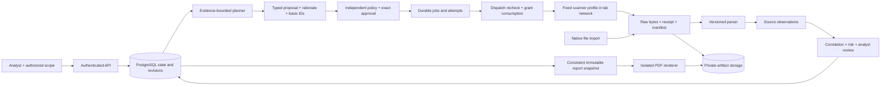

# CoreVAPT architecture fit review

Reviewed: 2026-11-02. Status: research and proposed design corrections, not a running platform or performance evaluation. Mandatory input: the user-provided [1.pdf](../../1.pdf), all ten physical pages; [source manifest](sources/requirements-1-provenance.json). The retained research PDF is byte-identical. Page 9 was also rendered and visually checked to confirm the rubric table.

## 1. Decision

**Keep the modular monolith, a separate durable worker, PostgreSQL, private artifact storage and a contract-driven frontend. Tighten the interfaces and evaluation before adding infrastructure.** This structure fits the stated assessment lifecycle and solo development scope. It does not establish that the platform meets the requirements: no backend/scanner implementation exists in the reviewed checkout.

The current repository is a research and prototype workspace. The proposed application structure is a design, not an existing codebase. Its main risk is fragmented ownership of state, contracts and evidence, rather than a shortage of services or agent roles.

## 2. Actual checkout versus intended application

| Present in the checkout | What it proves | What it does not prove |
| --- | --- | --- |
| `1.pdf` and matching retained copy | An inspectable local requirements baseline | Identity with a subsequently updated public attachment |
| `docs/research/` | Requirements, prior-art research and design rationale | Implemented tool integration or measured detection quality |
| `docs/superpowers/specs/` and `plans/` | Proposed ownership, interfaces, parallel tasks and acceptance | Executable OpenAPI, applied migrations or a runnable platform |
| `corevapt_frontend_v6.2.html` and V6.1 | Standalone frontend artifacts with simulated assessment workflows | Authenticated API, real model reasoning, live scanner execution or server PDF |
| `tests/prototype-v6.2.spec.cjs` and screenshots/sample PDF | Available frontend verification artifacts; inspect their own run record before citing results | Platform E2E, native scanner parser correctness or production readiness |
| `.agents/skills/` | Development workflow instructions copied into the workspace | Product runtime modules or proprietary security capabilities |

There is no `backend/`, production `frontend/`, executable `contracts/openapi.yaml`, database migration tree or `compose.yaml` in the inspected application checkout. Do not describe the proposed directory tree as already implemented. The frontend is being worked on independently; this review does not modify HTML, tests or screenshots.

## 3. Fit against the mandatory PDF

| Requirement and PDF location | Structural support | Correction or missing evidence |
| --- | --- | --- |
| Natural-language request and auditable plan, §§2–3, pp1–2 | Assessment + planner + decision records | Persist conversation messages and decisions separately; a request string plus deterministic UI scenario is insufficient AI evidence |
| Scope/exclusions/permissions, §5.1, p3 | Versioned scope + independent policy + scanner network gate | Scope must be enforced at actual destination, including redirects, DNS and IPv6; a UI checkbox is not authorization |
| Adaptive next step, §5.2, p4 | Planner reads normalized evidence, catalog, coverage and budgets | Evaluate counterfactual branches and stop decisions, not just JSON validity or the presence of HTTP in one example |
| Scan/error lifecycle, §5.3, p4 | Durable worker + attempt/receipt + bounded process supervisor | Define host launcher ownership and receipt protocol; “host-managed launcher” alone is not an implementable integration |
| Three working integrations/imports, §6, p5 | Nmap live, ZAP bounded baseline live, Greenbone native XML import | Obtain genuine native Greenbone export early; two live tools plus synthetic XML do not satisfy three integrations |
| Normalization/correlation, §§5.4–5.5, p4 | Separate observations, findings and membership records | Include asset/service/endpoint/time identity, rule equivalence and analyst overrides; preserve conflicts and historical uncertainty |
| Risk, §5.6, p4 | Versioned findings/risk policy | Persist CVSS vector/version/source, exposure, exploitability evidence, asset impact and confidence method; unknowns must remain visible |
| Human approval, §§5.7/9.5, pp4/7 | Exact action hash, authenticated reviewer, expiry and atomic dispatch authorization | Backend gate tests prove control behavior. They do not prove controlled active validation; organizer permission and permitted capability remain an acceptance gap |
| Professional PDF, §7, pp5–6 | Immutable report snapshot + isolated renderer + authenticated download | Render six required sections from a consistent revision, including failure/coverage/approval limitations; browser print is separate evidence |
| Genuine status and attribution, §§3/6/13, pp2/5/10 | Timeline, capabilities, actor/event log and receipts | Separate tool coverage, action state, finding validation, hypothesis outcome and verification level |

The PDF requires adaptive planning at the functional level; multi-step adaptive replanning/state memory is advanced in §6. A bounded evidence-dependent branch is essential. A large autonomous attack graph is not required.

## 4. Recommended application layout

This is the implementation target. Preserve the existing documentation and prototype as source material.

```text
1.pdf
README.md
contracts/
  openapi.yaml                 # HTTP source of truth, frozen at G0
  examples/                    # valid and invalid fixtures used by FE/BE/QA
backend/
  pyproject.toml
  alembic/                     # one migration graph and integration owner
  src/corevapt/
    app.py                     # composition root, no business rules
    config.py                  # typed configuration and secret references
    contracts.py               # initial public DTO facade; module internals stay local
    foundation/                # sessions, auth, event append, idempotency, capabilities
    assessments/               # scope versions, requests, conversation, coverage revision
    artifacts/                 # immutable bytes, manifests, integrity and reconciliation
    policy/                    # decisions, approval binding, dispatch authorization
    planner/                   # bounded evidence context, proposals, semantic validation
    findings/                  # ingest, membership/correlation, risk and review
    adapters/                  # native parse + declared execution capabilities
    worker/                    # generic jobs, attempts, process supervision and recovery
    reports/                   # consistent snapshots, template, PDF render
  tests/
    unit/
    integration/
    fixtures/                  # native/synthetic provenance manifest
frontend/                      # owned by user-designated frontend agents
ops/
  lab/                         # isolated targets, egress tests and fixed launcher spec
scripts/                       # contract checks, acceptance runner, local smoke
tests/acceptance/              # root acceptance registry
docs/implementation/evidence/  # run records; sensitive artifacts remain private
```

The root acceptance registry and evidence paths are separate from backend package tests. This layout preserves the parallel plan's ownership. It does not require every responsibility to become a new package, process or database table.

Use a small public contract facade initially. If it grows, split DTO definitions by domain behind stable exports with coordinated changes; avoid a central file containing all business logic. Within `findings/`, correlation and risk can remain focused internal modules. Do not create separate services just to match rubric categories.

## 5. Data and control flow



A generic job is not a tool execution. Import and PDF jobs reuse claim/lease/heartbeat infrastructure but have their own resource states and idempotency semantics. A report job must not require a scanner grant. Keep job scheduling outside `policy/`; keep permission decisions outside the worker's tool-specific implementation. One worker codebase can dispatch several job kinds without a broker.

PostgreSQL documents `SKIP LOCKED` as useful for queue-like consumers, with caveats; this supports a claim primitive, not an exactly-once execution guarantee. Receipts, attempt fencing and reconciliation remain application responsibilities. [PostgreSQL SELECT](https://www.postgresql.org/docs/current/sql-select.html).

## 6. Required design corrections before G0

| Priority | Correction | Owner / acceptance |
| --- | --- | --- |
| P0 | Canonical OpenAPI plus complete profile parameter/snapshot/ParsedBatch schemas | Contract owner; schema examples and negative fixtures validate; no arbitrary scanner JSON |
| P0 | Conversation and decision persistence | Assessment/planner; user request, assistant proposal, provider identity, basis IDs, revision, uncertainty and outcome survive restart |
| P0 | Separate generic jobs, tool executions and report states | Foundation/worker/report; import/render can run without scanner approval and cannot accidentally execute a scanner |
| P0 | Explicit risk context contract | Findings/assessment; analyst-supplied owner/impact/exposure have source/time and unknown behavior; source severity is immutable |
| P0 | ZAP launcher protocol and egress ownership | Worker/integration; fixed service/job descriptor, trusted caller, exact scope/profile/attempt binding, completion receipt and bounded cancel; no planner-controlled Docker socket |
| P0 | Native fixture acquisition deadline | Adapter/QA; genuine source manifest exists or third-integration replacement is explicitly decided before native integration work is assumed complete |
| P0 | Active-validation acceptance disclosure | Coordinator; identify permitted validation method and organizer response; gate-only/fake-runner demo is labelled as such |
| P0 | Evidence-backed evaluation and prompt-injection cases | QA/planner; independent labels, explicit denominators, no tool-data instruction can change scope/permissions |
| P1 | Restore drill, retention and operator diagnostics | Integration; demonstrate DB+artifact backup restoration, disk/lease/orphan checks before a real client pilot |
| P1 | Remediation ownership and retest links | Findings; append follow-up state to existing evidence rather than rewriting released reports |

ZAP baseline runs a spider before passive analysis, and Nmap version detection sends probes. Their traffic is subject to the lab ROE. ZAP baseline also uses distinct exit codes for policy alerts and runtime errors; a nonzero code alone cannot classify a scan as failed. [ZAP baseline](https://www.zaproxy.org/docs/docker/baseline-scan/), [Nmap version detection](https://nmap.org/book/man-version-detection.html).

Scanner output is untrusted input, including instructions embedded in banners or HTML. The planner should read bounded evidence projections, validate proposed action/evidence identity, and rely on independent authorization. Prompt wording is only one defense. [OWASP prompt injection guidance](https://cheatsheetseries.owasp.org/cheatsheets/LLM_Prompt_Injection_Prevention_Cheat_Sheet.html).

## 7. Architecture alternatives

| Approach | Benefit | Cost or mismatch | Decision |
| --- | --- | --- | --- |
| Proposed modular monolith + worker | End-to-end ownership, small deploy footprint, precise action/evidence contracts | Must implement a narrow durable job lifecycle and normalization well | Recommended for contest MVP and a single-organization pilot |
| Put an AI layer on an established findings platform | Reuse imports, triage and collaboration | Its ingestion/dedupe/workflow semantics may not satisfy action-bound approvals or adaptive orchestration; deployment and data translation overhead | Candidate downstream integration; evaluate against contracts, not a forced dependency |
| Fork a complete autonomous pentest framework | Existing tool loop/state machinery | Broader execution authority, dependency footprint and harder explanation of local contributions/safety; report/provenance contracts still need work | Do not make this the default architecture |
| Microservices, distributed agents and separate event infrastructure | Independent scale and team ownership | No measured bottleneck or multi-team requirement in this project | Defer until demonstrated operational need |

See [current solution research](SOLUTION_LANDSCAPE.md) for source-specific capabilities, license caveats and adoption boundaries. These decisions are design inferences, not benchmark findings.

## 8. Real-world fit and release boundaries

The strongest initial user is an authorized internal analyst or small consultancy combining network/web evidence into a reviewed client report. Their repeated problem is coordination, review effort and traceability. The product should retain that workflow instead of expanding to autonomous exploitation to appear more sophisticated.

Contest-ready is not client-ready. A real pilot needs signed engagement scope, per-assessment access control, secure storage/retention, model data policy, reproducible evidence, reliable recovery and a tested restore procedure. These are acceptance gates with owners, not reasons to introduce Kubernetes or a tenant platform during the contest. A multi-client hosted service later needs stronger isolation, reviewer roles, TLS/secret lifecycle and operational response procedures.

NIST SP 800-115 supports assessment planning, analysis and mitigation workflow; citing it does not establish formal compliance. [NIST publication](https://csrc.nist.gov/pubs/sp/800/115/final).

## 9. Evidence limits and next action

This review read the local requirements, current project documentation and current primary web sources. It did not build dependencies, execute tools, call a model, validate external lab permissions or measure detection quality. Local PDF extraction emitted a metadata-object warning but produced all ten pages; the rubric was independently checked in the rendered page.

Next: use the [metrics and real-world evaluation plan](COMPETITION_METRICS_AND_REAL_WORLD.md), complete G0 schemas with the above corrections, and execute one request-to-evidence-to-PDF vertical slice before expanding adapter breadth. Frontend remains assigned by the user and can continue in parallel against the frozen contracts.

## 10. Follow-up decision outputs

The [readiness report](READINESS_DECISION_REPORT.md) resolves research-level choices from this review. It links exact scanner selectors/provenance gates, typed G0 semantics, a conditional model experiment, a narrowly exposed host launcher with reservation/final-start fencing, and pilot recovery controls. The proposed architecture remains unchanged at the product level. All implementation, live networking, actual model-quality and organizer-authorization gates retain their own evidence requirements.
