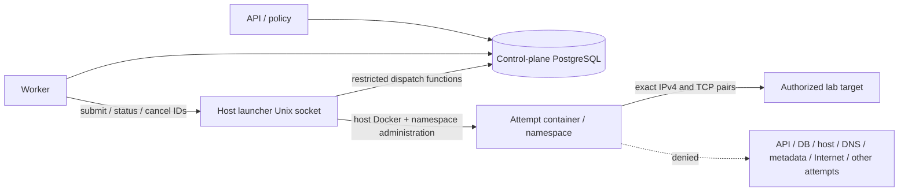

# CoreVAPT safety, recovery, and pilot decisions

Research date: **2026-11-02**. Status: **proposed design, source-verified; runtime unverified**. This document recommends decisions for the [architecture review](ARCHITECTURE_FIT_REVIEW.md), [platform design](../superpowers/specs/2026-11-02-corevapt-platform-design.md), [contracts](../superpowers/specs/2026-11-02-corevapt-contracts.md), [worker/scanner plan](../superpowers/plans/2026-11-02-03-worker-scanners.md), and [report/delivery plan](../superpowers/plans/2026-11-02-04-reports-delivery.md). It does not amend those files or authorize implementation.

The mandatory [1.pdf](../../1.pdf) was read with `pdftotext -layout 1.pdf -`, including all ten physical pages. Its §§5.1, 5.3, 5.7, 7.6, 9.5, and 13 require scope control, execution/error records, explicit approval for offensive validation, disclosed limitations, an approval demonstration, and lab-only assessment integrity. Recommendations below are engineering choices, not additional organizer rules or claims of legal or standards compliance.

No scanner, application, container, firewall, database, model, or cloud workload was started for this research. No dependency was installed. Verification cases in this document are **proposed, not run**.

## 1. Decisions to adopt before live execution

| ID | Recommendation | Boundary / release consequence |
| --- | --- | --- |
| S1 | Keep the modular monolith, PostgreSQL queue, existing worker, and private immutable artifacts | Add one narrow local execution helper, not a new product orchestration platform |
| S2 | Use a host-only allowlisted launcher and one network namespace per attempt | Worker, API, planner, and scanner never receive the Docker socket or general host execution authority |
| S3 | Admit one dedicated IPv4 lab target and exact TCP destination pairs per attempt initially | Hostnames are fixed aliases; DNS, IPv6, CIDR discovery, shared virtual-host targets, and path-scoped assessments are unavailable in the first live profile |
| S4 | Prepare the network with no scanner process, then perform an online final start authorization | A worker's earlier permit is a reservation, not a reusable instruction to start later |
| S5 | Treat dispatch as an auditable at-most-one start intention per attempt, with uncertainty after failures | Database transactions and leases do not establish exactly-once scanner execution or exactly-once target effects |
| S6 | Require evidence-backed network, cancel, crash, access, and restore gates before a pilot | A source review, configuration file, or approval screenshot cannot satisfy the corresponding live gate |
| S7 | Leave offensive validation unavailable until the organizer resolves §9.5 and permits a specific action | Gate-only demonstrations remain explicitly incomplete evidence for the active-validation deliverable |

## 2. Two feasible runner approaches

| Approach | Concrete structure | Advantages | Cost / limitation | Decision |
| --- | --- | --- | --- | --- |
| A. Per-attempt namespace and fixed local launcher | One small trusted host daemon creates a fresh empty Docker internal bridge and starts only a fixed wait shim there. The daemon installs that namespace's firewall before attaching the registered target or starting a scanner, performs final database authorization, then releases the shim to a catalogued binary | One actual destination boundary serves both Nmap TCP connect and ZAP HTTP; no direct scanner access to control services; rules and receipts have attempt identity; no new broker or remote runner | Requires Linux, privileged host administration, a tested Docker/firewall combination, and a small fixed wrapper image. The host launcher is trusted and powerful | **Recommend local mode first; independently accept routed mode only if the organizer lab needs it** |
| B. Persistent scanner sidecars with a mandatory HTTP proxy | A fixed Nmap service has its own host firewall rules; a fixed ZAP service has direct egress denied and reaches targets only through an origin-validating proxy; the worker has typed service APIs | Can use persistent scanner processes and an HTTP proxy for hostname/origin checks | Two distinct egress mechanisms; proxy bypass must be independently blocked; Nmap does not become constrained by an HTTP proxy; ZAP state, callbacks, API exposure, and per-assessment cleanup add lifecycle work | Defer unless a real requirement needs authenticated web sessions or shared-host origin controls |

An internal Docker bridge by itself is insufficient for either approach. Docker documents that containers on the same bridge can reach each other's ports; an internal network does not express an assessment's host/port exclusions. Internal mode also permits communication with its gateway IP and appropriately configured host services, while the host can reach container IPs. A worker connected to both a control and scanner network also creates an unnecessarily broad foothold. Keep these planes separate. [Docker bridge networking](https://docs.docker.com/engine/network/drivers/bridge/), [Docker internal-network behavior](https://docs.docker.com/reference/cli/docker/network/create/#network-internal-mode---internal).

Approach A is a bounded proposal, not an assertion that these host prerequisites already exist. If the namespace/firewall integration cannot be accepted, publish the corresponding live capability as `unavailable`; retain imports and parser development without a less constrained execution fallback.

## 3. Trusted identities and permitted interfaces

| Identity | May do | Must not receive |
| --- | --- | --- |
| Authenticated analyst | Read assigned assessments, propose scope revisions, approve exact supported actions, request cancellation, download assigned evidence | Caller-selected actor identity, system administration, direct scanner or Docker credentials |
| API/policy component | Validate membership/ROE/capability, maintain immutable scope/action/grant records, reserve a permitted attempt | An arbitrary Docker or shell tool |
| Planner/model | Read bounded evidence projections and propose typed profile IDs, targets, rationale, and basis IDs | Launcher access, signing keys, approval authority, filesystem paths, raw credentials |
| Worker service identity | Claim typed scan/import/report jobs; request launcher submit/status/cancel for its current scan attempt; ingest receipts/artifacts | Docker socket, `docker` group membership, `sudo`, arbitrary executable/argv/image/mount/network selectors |
| Host launcher service | Use the local Docker Engine; configure namespaces and only its own firewall objects; call restricted dispatch functions; supervise exact attempt containers | LLM-controlled configuration or a public HTTP endpoint |
| Scanner UID | Execute the fixed tool profile with bounded local working/output space and target traffic | API/DB/model credentials, launcher socket, host/PID namespaces, devices, Docker socket, `CAP_NET_ADMIN`, or `CAP_NET_RAW` |
| Import parser / PDF renderer | Read bounded immutable inputs and produce normalized data or PDF | Scanner permissions; renderer network access or target credentials |

The launcher is part of the trusted computing base. Access to the Docker daemon carries extensive host authority; moving it to a restricted helper reduces exposed interfaces but does not make a compromised launcher safe. Run this pilot on a dedicated lab host, with the operator and host administrator in the same trust domain. Container isolation alone does not establish resistance to a hostile multi-tenant workload. [Docker daemon access guidance](https://docs.docker.com/engine/security/protect-access/).

The worker connects to a root-owned local Unix socket, for example `/run/corevapt-launcher/control.sock`, mounted only into the worker. The launcher verifies kernel peer credentials against the configured host UID/GID mapping and socket permissions. Rootless/user-namespace mappings must be explicitly tested; do not infer identity from a JSON `worker_id`. Each request is additionally matched to the current claimed attempt in PostgreSQL. The planner/API containers do not mount this socket. Remote TCP access and remote runner federation are out of scope.

Expose only bounded operations:

```text
submit(attempt_id, reservation_id, request_id) -> accepted | existing | denied
status(attempt_id) -> prepared | start_authorized | running | stopped | unknown
cancel(attempt_id, cancellation_id) -> requested | already_stopped | unknown
```

Requests are size-limited, reject extra fields, and contain no shell text, image, executable, environment, path, mount, network, or raw scanner argument. `submit` loads the immutable descriptor from PostgreSQL using a restricted launcher database role. Limit that role to named dispatch/status functions and required projections; it is not the application database owner. Define the functions' privileges, trusted schema/search path, transaction owner, and audit behavior at G0. A compromised worker cannot manufacture a valid grant by writing its own descriptor.

These boundaries follow OWASP's separation of proposal from execution and exact-action authorization. Banner/HTML/tool text remains untrusted data; no instruction contained in evidence can amend scope, approve a proposal, choose a binary, or change a launcher setting. [OWASP AI Agent Security](https://cheatsheetseries.owasp.org/cheatsheets/AI_Agent_Security_Cheat_Sheet.html).

## 4. Immutable job envelope and profile allowlist

The server-generated launch descriptor is versioned and bound to one attempt. Store its canonical hash in PostgreSQL and the launcher journal. Required fields:

| Group | Fields / constraint |
| --- | --- |
| Identity | `descriptor_version`, `instance_generation`, `assessment_id`, `job_id`, `execution_id`, `action_id`, `attempt_id`, `attempt_fence`, `reservation_id` |
| Authorization | `scope_version`, `scope_hash`, `action_hash`, `grant_id` where required, actor/audit references, ROE reference/hash, `not_before`, `start_before`, hard `stop_at` |
| Profile | Catalog ID/version, root-owned image digest mapping, fixed executable/entrypoint version, adapter/parser version; incoming requests cannot supply an alternative image |
| Destinations | One canonical IPv4 target, an exact set of `(IPv4, TCP port)` pairs, approved URL origin for ZAP, optional fixed hostname-to-IP alias, deny-precedence exclusions |
| Limits | Action/runtime budget reservation, fixed concurrency, CPU/memory/PID/working-space/output bounds, truncation policy, cancellation grace |
| Evidence | Basis observation IDs, private server-generated attempt/output identifiers, descriptor hash, expected artifact names/formats, launcher/network policy versions |

`instance_generation` is a host-controlled restore generation, so a restored database cannot revive a token from before recovery. `attempt_fence` is monotonic for the execution and is checked on heartbeat, start, completion, cancellation, and artifact attachment. UUIDs identify rows; fences establish the current generation. The action hash must bind this profile version and the relevant target/parameter/scope/budget fields. Do not silently change image/profile behavior after approval.

Proposed initial profile constraints, subject to pinned-tool smoke tests and the actual lab ROE:

| Profile | Accepted input | Fixed behavior | Rejected |
| --- | --- | --- | --- |
| `nmap_discovery_v1` | One numeric IPv4; 1–16 explicitly listed allowed TCP ports | Unprivileged TCP connect, no DNS, host considered up, light version detection, XML output, one target at a time, at most 120 seconds | CIDRs/ranges, UDP, raw/SYN scan, OS detection, `-A`, NSE/scripts, hostname resolution, extra flags |
| `zap_baseline_v1` | One approved HTTP(S) origin on a dedicated lab IP/port, root path, optional fixed approved hostname alias; prior HTTP-service observation in the same assessment | Packaged AF-only baseline, fixed one-minute traditional spider/passive wait, fixed `-P 8090`, full JSON, fixed `-z` value `-silent`, no Ajax spider, at most 180 seconds including analysis | Active/API/full scan, shell/hook files, caller-supplied `-z` or flags, config URLs, context/user files, `--autooff`, authentication scripts, credentials in URL, shared-IP virtual-host scope, path exclusions the gate cannot enforce |

These numeric caps are **proposed safety defaults, not measured scanner performance**. Decrease them to match the ROE. If a lab requires a request-per-second guarantee, verify an actual pinned-tool rate-control mechanism before enabling the profile; a time limit or low worker concurrency does not establish a request-rate limit. ZAP baseline spiders the application before passive analysis, so it sends assessment traffic; its nonzero alert/policy exits also differ from execution errors. [ZAP baseline scan](https://www.zaproxy.org/docs/docker/baseline-scan/).

The launcher compiles typed input into fixed argv using a process API, with no shell. The image's fixed wrapper selects only its compiled-in profile and binary. The original worker `run_process(argv, ...)` seam remains useful for test helpers and non-scanner local jobs; it must not become the public launcher API. Greenbone remains an import and receives no live network grant. Report/import jobs reuse the queue but never consume a scanner grant.

Align ZAP with the [scanner-readiness decision](SCANNER_READINESS_DECISIONS.md): fixed `--auto -m 1 -T 1 -J baseline.json -P 8090 -z -silent`, where `-silent` is one fixed argv value, not caller options. Prepackage required add-ons. The inspected pinned script suppresses automatic add-on update/install when `-silent` is present, selects an ephemeral port unless `-P` is supplied, and can fall back to legacy execution for unsupported AF options. Reject `-n`, `-U`, `--hook`, `--autooff`, `-u`, `-j`, and all other non-catalog options; verify the generated plan's permitted phases and AF execution receipt rather than trusting `--auto` alone. Do not allow a legacy fallback. All chosen-image behavior and loopback binding still require runtime acceptance. [Pinned ZAP baseline source](https://github.com/zaproxy/zaproxy/blob/528bdf4c8c808342cb1f12314a2492c8d3e0b551/docker/zap-baseline.py).

## 5. Actual egress boundary for approach A

### 5.1 Concrete topology and preparation

Use one ordinary Linux host running Docker Engine, the control-plane Compose stack, and organizer-authorized local lab targets. This is not a cloud deployment proposal. Prefer a Docker-managed **internal per-attempt bridge**, which supplies local connectivity without custom veth plumbing or host routing. The namespace firewall supplies the assessment boundary; network membership alone does not.

The operator first registers a `lab_target_ref` in a protected inventory: organizer authorization reference, authenticated registering actor/time, exact target container ID/image identity for local mode or the actual organizer endpoint for remote mode, reserved non-overlapping bridge subnet and target `/32`, hostname mapping, permitted ports, validity, and one fixed topology mode. Allocate/confirm the target address before the action is hashed/approved. The launcher accepts only that inventory ID from authoritative server records; it never accepts a user-supplied Docker container name, network ID, label selector, image, or subnet. Labels help reconciliation but do not establish authorization. An operator explicitly binds the inventory entry to the organizer target; untrusted PDF/HTML/banner text cannot create an entry. A locally recreated target is not automatically an accepted competition target. One target/one attempt is sufficient; this is not a general network provisioner. See the [organizer confirmation pack](ORGANIZER_CONFIRMATION_PACK.md).



1. Reserve the attempt in PostgreSQL. Create a fresh attempt-labelled **internal IPv4 bridge** from the trusted inventory's non-overlapping address reservation, initially with no target attached. Journal its returned network ID and verify labels/members; a name alone is insufficient identity. Previous unknown/surviving attempts block subnet reuse. Docker manages the bridge and interfaces; no custom veth routes or Docker host-chain edits are needed.
2. Create a deterministically named container, for example `corevapt-attempt-<UUID>`, on that empty bridge with an immutable descriptor label. Start only a **trusted wait shim** from the pinned derived scanner image: unprivileged UID, all capabilities dropped, `no-new-privileges`, read-only root filesystem where the pinned scanner permits it, bounded tmpfs/work/output, and no published port. The scanner binary has not started, and the untrusted target is not attached. Docker name conflicts require inspection, never a different retry name. [Docker run privileges and resource controls](https://docs.docker.com/engine/containers/run/), [Docker run options](https://docs.docker.com/reference/cli/docker/container/run/).
3. The host launcher obtains the container ID, PID plus process start identity, host boot identity, and network-namespace identity. It opens the namespace handle and verifies that identity before any modification. Atomically install and read back the namespace ruleset below before any scanner process or target attachment. Configure IPv6 disabled and retain explicit IPv6 drop rules. The shim is the only trusted process allowed to run before preparation; it never initiates target traffic.
4. Attach only the registered lab target to that attempt bridge at its approved address. The scanner never joins a control-plane or shared assessment network. Reject a network with unexpected members, attached services, published scanner ports, IPv6 configuration, or external routing in local mode. Preserve target authorization and identity if its previous lab network changes; a multi-homed target needs separate operator isolation and must not be used as a router.
5. Install the fixed hostname mapping at container creation. Docker's embedded resolver is explicitly blocked, including `127.0.0.11`; it is not a permitted path. After target attachment, read back effective rules, addresses/routes, members, DNS/hosts files, capabilities, mounts, and namespace identity and hash them into a `prepared` receipt. Policy must remain present throughout preparation and after attachment. Failure keeps the shim unreleased.
6. Perform the online final start fence in §6. Only after it succeeds, publish the launcher-owned release record into a directory mounted read-only into the container. The fixed shim checks the descriptor hash, attempt identity, deadline, and release record, starts the fixed scanner once, and never interprets commands from the file. Its marker records release/start separately from scanner exit.

The shim and launcher need implementation and adversarial review. They are a small proposed integration, not existing verified code. Cost/privilege prerequisites are a root-managed host service with Docker Engine access and namespace-entry/firewall privileges, pinned derived scanner images containing the shim, an approved local target inventory, private journal/spool capacity, and acceptance of that host's actual firewall behavior. If any privilege or prerequisite is unavailable, keep live profiles unavailable; import/parser/renderer work can proceed. The launcher owns Docker lifecycle; there is no `docker exec` or general process endpoint for the worker. After release, loss of worker heartbeats does not stop the independent launcher deadline watchdog. Following launcher restart, reconciliation precedes new releases.

Do not assume that a container created with `--network none` can be directly attached to another network on every Engine version: Moby documents this special-mode compatibility issue. The sequence above uses an initially empty internal bridge and a trusted shim instead, and still installs enforcement before the scanner or target starts interacting. `--network none` remains the safe disabled/diagnostic mode and has only loopback. [Moby network-none issue](https://github.com/moby/moby/issues/21132), [Docker none driver](https://docs.docker.com/engine/network/drivers/none/).

### 5.2 Target-topology compatibility and remote mode

| Organizer target topology | Proposed mode | Necessary gate / limit |
| --- | --- | --- |
| Explicitly authorized local target container with an approved dedicated address | `local_internal` as above | Target identity and address mapping authorized; bridge membership, positive target reachability, and forbidden canaries accepted |
| Dedicated organizer IPv4 `/32` on an external lab subnet or approved VPN | `remote_routed` with a Docker-managed per-attempt **non-internal bridge**, plus the same namespace default-drop exact tuple policy | Independent routing/NAT/VPN and allow/deny acceptance on the actual endpoint topology; never infer from local mode |
| Shared-IP virtual host, path-only authorization, rotating hostname/DNS, IPv6-only, arbitrary target list | Unsupported in initial live profiles | Reject before dispatch; a broader schema/control design and acceptance are required |
| Missing host privileges, authorization, inventory binding, or accepted routing | `disabled` / `--network none` | Live unavailable; imports, parsers, and other isolated jobs can proceed |

Remote mode changes **reachability**, not execution authority. The root-managed inventory and signed ROE select it; a model/browser request cannot choose a raw network or enable public routing. Create a fresh scanner-only Docker bridge using normal Docker routing/masquerading and no control-plane endpoints. Start only the trusted wait shim there; install/read back the same namespace input/output/forward deny policies before releasing any scanner. This bridge's broad default route is not an allowlist: the namespace permits only the approved organizer `/32` and exact TCP port pairs, blocks host/gateway/metadata/control-plane tuples, DNS and IPv6, and uses static hosts mappings. Reject an inventory target that overlaps host/control-plane addresses, loopback, link-local/metadata, unspecified/multicast, or a conflicting local bridge route; private organizer lab addresses can still be valid when their actual route is unambiguous. Fixed binaries, no scanner capabilities/sockets/secrets, final start fence, receipts, and cancellation remain identical. [Docker bridge routing/masquerading](https://docs.docker.com/engine/network/drivers/bridge/).

The operator verifies the real host route and Docker forwarding/NAT to that organizer lab, including VPN return paths and any overlapping private subnets. Record the selected route/interface and effective firewall backend; a working host-side connection is insufficient to prove the container path. No custom veth implementation or global firewall relaxation is prescribed. Missing routes, NAT restrictions, VPN policy, or required privilege leave remote mode unavailable. Do not silently switch networks or relax the tuple gate to make connectivity work.

Before enabling remote mode, independently demonstrate allowed endpoint reachability and forbidden harness canaries, API/DB/host/metadata denial, pinned-hostname behavior, DNS/IPv6 denial, and redirect blocking through the actual routed namespace. Confirm which lab endpoints/canaries are authorized before probing. A local internal-bridge pass does not establish remote mode safety or liveness. Until this evidence exists, keep the capability unavailable and the scanner unreleased; a no-network diagnostic never counts as a working integration.

Linux network namespaces have distinct routes and firewall state; locally generated IP packets traverse the output hook. That makes a namespace output policy suitable for constraining both scanner tools, including direct connections that bypass proxy configuration. This is a design inference from documented primitives, pending the live cases in §10. [Linux network namespaces](https://man7.org/linux/man-pages/man7/network_namespaces.7.html), [Netfilter hooks](https://wiki.nftables.org/wiki-nftables/index.php/Netfilter_hooks).

### 5.3 Ruleset semantics

The namespace has an `inet` table with explicit input, output, and forward **base chains**, all default-drop. A regular chain without a hook does not filter traffic; an omitted drop policy defaults to accept. [nftables chain configuration](https://wiki.nftables.org/wiki-nftables/index.php/Configuring_chains).

- **Output:** drop all IPv6 first. For target traffic, permit TCP only when destination address and port match the same exact approved tuple, using an address/port concatenation set rather than two independent allowlists; apply this restriction to subsequent packets too. Only ZAP additionally permits local client requests from `127.0.0.1` to `127.0.0.1:8090` and established local return traffic from source `127.0.0.1:8090` to its requesting client. Nmap has no loopback exception. Deny all other loopback including `127.0.0.11`, all UDP/DNS, ICMP assessment probes, host gateways, metadata/link-local, other ports/targets/attempts. There is no broad established/related output bypass.
- **Input:** permit established replies from the approved target address/source-port tuples. For ZAP's exact `127.0.0.1` loopback control flow, permit the request to TCP 8090 and established responses from source TCP 8090; reject other loopback. Drop unsolicited external inbound and all IPv6. Verify the actual pinned wrapper/daemon remains on this flow; an unexpected port/bind fails the profile gate. No API port is published to other containers or the host.
- **Forward:** drop. A scanner namespace is not a router. No raw socket or network-administration capability is available to the scanner UID.
- **Docker host:** keep Docker-managed rules intact. Local mode's internal bridge contains only this target and attempt; remote mode's ordinary bridge contains only the attempt. The namespace output policy rejects host/gateway addresses and all non-target tuples in both. Do not add a general host-forwarding exception or publish scanner ports. Accept membership and effective host isolation on the pinned backend; independently accept remote routing/NAT where used. The namespace rules remain the exact destination boundary rather than relying on Docker's broad same-network access.

Do not assert that a UFW rule or a `DOCKER-USER` recipe works for every backend. Docker manages host filtering and may set forwarding drop policy; its published-port paths can bypass UFW assumptions. Host routing/firewall compatibility is therefore an explicit prerequisite, not something to fix by disabling Docker firewall management or globally allowing forwarding. [Docker packet filtering and firewalls](https://docs.docker.com/engine/network/packet-filtering-firewalls/).

### 5.4 DNS, redirects, and the honest scope limit

The first live profile uses a numeric target or a launcher-created exact hostname alias pinned to that same dedicated IPv4 address. All DNS traffic and IPv6 traffic are denied. An out-of-scope redirect, absolute link, image, WebSocket, or direct socket to a different IP/port is still subject to the kernel tuple gate. Network acceptance must inspect canary traffic, not just the ZAP context configuration. OWASP identifies redirects and changing A/AAAA answers as allowlist bypass concerns. [OWASP SSRF prevention](https://cheatsheetseries.owasp.org/cheatsheets/Server_Side_Request_Forgery_Prevention_Cheat_Sheet.html).

An IP/port firewall **cannot** distinguish two virtual hosts on the same IP/port, URL paths, HTTP methods, or actions that the target itself performs. Therefore the initial pilot requires the entire dedicated lab origin to be authorized; it rejects shared-host and path-exclusion scopes it cannot enforce. A ZAP context is an additional scanner constraint, not proof of a kernel-enforced URL boundary. Nor does this design prevent an allowed target from making its own out-of-scope outbound requests: the lab operator must separately isolate targets and exclude unsafe target behavior. Do not present scanner egress controls as target-side isolation.

## 6. Transactional dispatch, scope races, and fencing

### 6.1 Durable transitions

Keep public execution states from the existing contract. Add internal attempt phases rather than overloading `running` to mean that a scanner already exists:

```text
claimed -> dispatch_reserved -> prepared -> start_authorized -> started -> stopped
                                                  \-> reconciliation / unknown
```

`authorize_dispatch` is the **reservation** transaction: lock the assessment, action, approval/grant, budget, and job/attempt in a fixed order; validate membership references, scope/hash/profile, start expiry, current fence, capabilities, and budget; bind the grant exclusively to that attempt; persist intent and budget reservation. A reservation is never automatically released because a worker lease expired. Return a descriptor reference, not an indefinite start token.

The launcher prepares the namespace, then calls `authorize_start(attempt_id, attempt_fence, descriptor_hash, prepared_receipt_hash)` through its restricted database identity. This second short transaction locks the same assessment serialization row first and rechecks current scope version/hash, revocation/cancel state, grant binding/expiry, limits, instance generation, preparation identity, and live capability gate. It atomically consumes the reserved grant and writes `start_authorized` with a bounded start deadline and audit event. No database transaction spans the scan. Scope revision, revocation, grant rejection, and start authorization use the same lock ordering and row.

This final committed authorization is the **logical dispatch linearization point**:

- If a scope revision/revocation commits before it, the old attempt cannot pass; the shim is never released and scanner start count is zero.
- If start authorization commits first, that attempt was authorized under that version. A subsequent revision invalidates undispatched attempts and requests bounded cancellation of affected dispatched attempts. Audit both versions and cancellation outcome.
- A time gap remains between database commit and physical process start. Recheck the launcher journal's cancel flag and deadline before release, but do not claim that PostgreSQL and a local process form one atomic transaction. A change after the logical dispatch point may race with initial traffic. If the operator requires immediate physical no-traffic revocation, stop/quiesce the attempt and verify it before reporting the scope change as operationally effective.

An old worker cannot complete the attempt after a newer fence exists: updates require the current `attempt_id`, `attempt_fence`, worker/launcher identity, and valid instance generation. Queue claims use short row locks and `SKIP LOCKED`, with eligibility checked in the same transaction. PostgreSQL describes queue-like use while warning that skipped rows give an inconsistent view; this primitive is not a scanner-delivery guarantee. [PostgreSQL SELECT locking](https://www.postgresql.org/docs/current/sql-select.html).

### 6.2 Duplicate requests and receipts

The launcher serializes each attempt in a root-owned durable journal, fsyncs intent before release, and uses its deterministic container name and immutable labels to identify an existing attempt. A repeat submit returns the existing receipt. After an uncertain Docker create/start/release result, inspect the existing container and journal; never choose another name or blindly issue a second release. A release is immutable and tied to the prepared container ID. Restart policy is `no`; the shim never restarts a scanner. Do not use Docker automatic removal until raw bytes and final receipts are persisted and reconciled.

A receipt records `receipt_version`, descriptor/scope/action hashes, generation/fence, launcher build, host boot identity, container ID, PID/start identity, namespace identity, effective image digest/profile/tool versions, prepared rules/route hash, start authorization ID/time, release/start/stop times, exit/signal, deadline/cancel reason, artifact names/sizes/hashes, stdout/stderr truncation, and completeness/phase limits. Store immutable `prepared`, `start`, and `final` receipts so a missing final result does not erase the earlier evidence. The launcher can authenticate receipt bytes with a host-held HMAC key; that detects alteration by less privileged components, not fabrication by the trusted host administrator.

The worker attaches receipts and immutable artifacts only to their matching assessment/attempt/fence. Store raw output through a bounded, path-safe artifact publisher. Reject symlinks, hardlinks, devices, absolute paths, traversal, and unexpected output names; do not extract a scanner-produced archive directly into the host filesystem. Publish blob bytes atomically, then persist the manifest; reconcile the unavoidable database/filesystem gap. Parsing can repeat against those same bytes without scanning again.

### 6.3 Crash and reconciliation matrix

| Failure point | Durable evidence / recovery | Allowed next state / action |
| --- | --- | --- |
| API retries execution creation | Same actor/assessment/operation/idempotency key and body | Return original job/execution; changed body is 409 |
| Two workers claim one eligible job | Row lock plus current attempt/fence | One owner; other gets no claim; never two start reservations |
| Worker dies before reservation | Claimed row, no dispatch reservation; launcher confirms no accepted attempt | Requeue only under a documented claim-recovery rule; fresh authorization still required |
| Reservation committed, launcher not yet contacted | Reservation persists; query launcher journal and deterministic container name | Resume reconciliation for the same attempt. A replacement scan needs affirmative no-release evidence and an explicit retry/grant decision |
| Container/shim exists, network preparation fails | Container ID and prepared/diagnostic receipt; scanner absent | Stop/remove only that container; failed preparation; no release |
| Scope changes during preparation | Final authorization sees new scope or revoked grant | Deny, scanner start count zero; preserve preparation receipt |
| Start authorization commit response is lost | Query authorization row plus journal/container | Continue only if this exact authorization is proved committed and no conflicting release/cancel exists; otherwise unknown; no fresh attempt |
| Launcher dies around release/start | Intent, container/shim marker, labels, process start identity, raw files may be incomplete | Reconcile existing container; stop by exact identity if needed. If start/outcome cannot be proved, `execution_unknown`; no automatic rescan |
| Worker lease expires during a live scanner | Launcher independently owns deadline and container; stale worker cannot update fence | Reconcile/status; lease expiry is not permission to replay |
| Launcher dies while scan runs | Fixed hard deadline also enforced by shim; restart enumerates its labelled containers before new releases | Reconcile/stop exact attempt; absence of final receipt is not success |
| Scanner stops; receipt/raw stored; worker dies before ingestion | Verified receipt and hashes | Idempotent reparse/ingest of same artifacts; no new scan |
| Blob written; DB commit fails | Immutable blob plus orphan/publish journal | Retain for reconciliation; never report success solely from a file |
| DB manifest exists; raw missing or hash differs | Integrity check fails | Quarantine diagnostic, block verified download/ingestion; restore or mark evidence loss, never fabricate bytes |
| PID reused, host reboot, or container identity differs | PID alone is insufficient | Do not signal unrelated processes; unknown until exact container/start/boot identity is reconciled |
| Cancel, normal exit, and stale completion race | Current fence, launcher stop receipt, serialized terminal transition | One recorded terminal outcome; preserve late evidence without overwriting a newer attempt |

This provides duplicate suppression and conservative recovery, not exactly-once execution. A scanner can send a request and crash before any receipt, retry internally, or encounter a target whose effect cannot be observed. A transaction cannot roll back those packets. Even a container start count of one does not prove one target-side effect.

## 7. Cancellation, limits, and operational diagnostics

Cancellation is an authenticated assessment mutation with a stable cancellation ID. Persist the request before contacting the launcher. `cancel` identifies the exact container/attempt/fence, revokes namespace target egress first, terminates the shim's scanner process group, waits a fixed grace, then kills the remaining attempt container if needed. The launcher records whether the process is actually stopped and whether partial raw evidence is available. An HTTP 202 means request accepted, not stopped. Do not report `cancelled` solely because the worker wrote a flag.

Scope expiry and hard deadlines are also enforced by the launcher and fixed shim, independently of worker polling. If the launcher or database becomes unavailable, accept no new releases; existing attempts stop no later than their bounded local deadline, subject to the host/kernel remaining operational. On recovery, inspect surviving attempt containers before claiming this happened. The emergency operator procedure disconnects the exact attempt container from its bridge or stops the exact labelled container; it does not delete user volumes. Cleanup detaches only the inventory target's attempt network, removes only the attempt-owned network, and retains the target and evidence.

Proposed single-host pilot defaults: one live scanner globally across the host at a time; worker heartbeat every 5 seconds; 30-second lease; reconciliation every 15 seconds; cancel grace 5 seconds; no automatic live-scan retry. Validate timings under load. Deadlines and output bounds must be enforced by the supervisor, not merely passed as scanner suggestions. Use an output/work filesystem with a tested byte cap or quota and bounded stdout/stderr; output exhaustion produces a partial/failure receipt. Missing quota support must be disclosed and resolved before claiming a hard disk bound.

| Signal | Initial threshold / behavior | Required evidence or response |
| --- | --- | --- |
| Disk/inode reserve | Warn below 20% free; block launches/uploads below 10% or required worst-case job+backup reserve, whichever is stricter | Authenticated operator status plus bounded logs; preserve existing artifacts; never auto-delete referenced evidence |
| Expired live lease | One expired lease triggers reconciliation; unresolved beyond two reconciliation cycles alerts | Current attempt identity and launcher status; no replay |
| Orphan scanner or namespace | Labelled runtime without a current descriptor, wrong fence, or no deadline | Immediately quarantine/cut egress; investigate exact identity before removal |
| Orphan blob | Unreferenced bytes older than a proposed 24-hour grace | Dry-run inventory first; no deletion while backup/restore runs; never delete a referenced blob |
| Integrity mismatch | Any mismatch | Block verified download, preserve incident evidence, operator alert |
| Launcher/network drift | Missing base hook, changed rules hash, unexpected interface/route, lost acceptance version | Disable live capability and block releases until reaccepted |
| Backup health | No verified backup within proposed 24 hours, or last restore drill absent/failed | Block client pilot admission; label actual last backup/restore times |

A local authenticated diagnostics page and host service logs are enough for the first pilot; a monitoring cluster is unnecessary. Log who/what/when/outcome with action/attempt/request IDs and reason codes. Keep credentials, session tokens, sensitive bodies, and full target evidence out of routine logs. [OWASP Logging](https://cheatsheetseries.owasp.org/cheatsheets/Logging_Cheat_Sheet.html).

## 8. Minimum real-pilot admission gates

These gates are additional proposed operating conditions for real evidence, distinct from a contest demonstration.

| Gate | Concrete acceptance | Owner |
| --- | --- | --- |
| Signed ROE / target authority | Obtain an attributable signed engagement authorization from the lab owner identifying target IP/origin/ports, exclusions, profiles, times, traffic limits, credentials policy, cancellation contact, artifact/model data handling, and retention. A nonempty `authorization_ref` alone is insufficient | Assessment owner/operator |
| Named per-assessment access | Unique analyst accounts and explicit assessment membership. Check ownership on conversation, findings, approvals, reports, raw downloads, job status, and cancellation; no shared analyst login in a multi-person pilot | API/foundation |
| Sessions | HttpOnly SameSite cookies, CSRF protection on mutations, session rotation after login, idle/absolute expiry, server-side logout/revocation; Secure cookies and HTTPS when not strictly local | Foundation/integration |
| Approval integrity | Actor derived from session, exact immutable action preview/hash, expiry, current scope, one-attempt grant, auditable denial and cancellation; privileged unsupported profile remains denied | Policy/worker |
| Data minimization | Raw evidence stays private; routine planner context uses bounded structured extracts, redaction, and attributed source IDs. Send raw client content to a model only under the signed data policy and verified provider settings | Artifact/planner owner |
| Retention/redaction | Record owner-approved retention dates for raw artifacts, reports, audit, and backups. Suggested starting point is 30 days after assessment close, subject to explicit agreement. No public raw artifacts. A redacted derivative has its own hash and redaction manifest; original bytes are never silently overwritten | Operator/artifact owner |
| Storage/secrets | Restricted directories and service identities; encrypted host storage/backups; secrets outside images/Git/frontends; least-privileged DB identities. Confirm actual permissions and encryption settings in evidence | Integration/operator |
| Recovery | Complete the consistent backup and isolated restore drill below; recovery cannot release old approvals | Integration/operator |
| Live runner | All namespace, timeout/cancel, concurrent-dispatch, crash, and redirection gates accepted on the pinned host/runtime/profile versions | Worker/integration/QA |

OWASP distinguishes authentication from resource authorization and recommends permissions checks for every request; a valid account or an unguessable artifact UUID is insufficient. Its session guidance treats SameSite as an additional defense, not a replacement for CSRF protection. The proposed access/session controls above still need implementation and evidence. [OWASP Authorization](https://cheatsheetseries.owasp.org/cheatsheets/Authorization_Cheat_Sheet.html), [OWASP Session Management](https://cheatsheetseries.owasp.org/cheatsheets/Session_Management_Cheat_Sheet.html).

The retention value and alert timings are proposed defaults, not organizer mandates or compliance guarantees. Backups retain deleted data until their own expiry; document that delay rather than promising immediate erasure. Raw scanner output may contain secrets or personal data even when the report is redacted.

## 9. Consistent PostgreSQL and artifact backup / restore

### 9.1 Recommended pilot backup: a quiesced logical bundle

`pg_dump` creates a consistent single-database export, but that does not include external artifact files or launcher journals. It does not create a transactional snapshot spanning those stores. PostgreSQL also warns that copying a live data directory with ordinary file tools is not a valid substitute for a supported backup method. [PostgreSQL pg_dump](https://www.postgresql.org/docs/current/app-pgdump.html), [PostgreSQL file-level backup](https://www.postgresql.org/docs/current/backup-file.html).

For this small pilot, use a brief maintenance window rather than implementing continuous archive coordination:

1. Enter authenticated maintenance mode: reject new mutations, uploads, planning jobs, retention/deletion, and launches. Stop new worker claims and launcher releases. Let bounded jobs finish or cancel and reconcile them; wait for report/import/artifact writers and API transactions to finish. Prove no active scanner and no mutating job before the backup cut.
2. Record a bundle ID, UTC cut time, application/migration/profile/template/parser versions, instance generation, scope/state revisions, artifact count/size totals, and current terminal attempt/journal inventory. Keep the quiescence barrier until both database and files are captured.
3. Export the application database in custom format using a version-compatible `pg_dump`; preserve exit status and stderr securely. Save the controlled role/extension/configuration manifest needed for restore, and keep secrets/encryption keys in a separately protected operator recovery store. Do not put credentials in commands or evidence logs.
4. Copy every immutable blob referenced by that frozen database, including raw evidence, report snapshot JSON, PDFs, and final receipts, together with the launcher journal and manifest. Verify each stored byte hash and bundle inventory. Since writers/deletion are quiesced, this bundle has a shared application cut without claiming filesystem/database atomicity.
5. Encrypt the bundle and store a second protected copy outside the source disk's failure domain. Mark backup complete only after verification and successful copy. Then release maintenance mode. An incomplete bundle does not replace the previous known-good backup.

Proposed initial objectives are one backup each day and before a migration/demo, with a 24-hour RPO target and a two-hour RTO target. These are planning objectives until a timed restore establishes actual recovery; they are not measured service commitments. If downtime or daily RPO becomes unacceptable, separately design physical/WAL recovery and artifact-version retention; a database-only PITR claim is insufficient for external evidence consistency.

### 9.2 Restore drill: isolated first, scanner disabled

1. Restore into a new isolated database and artifact volume with outgoing scanner execution disabled. Keep the original data intact. Use only trusted verified backup bundles and pinned compatible software; migrations are explicit and separate from a first same-version restore.
2. Restore roles/extensions/configuration, database archive, immutable artifacts, and the matching journal snapshot. Verify all referenced hashes and inventories; check for dangling manifests and missing/corrupt blobs. Unreferenced extras remain quarantined pending reconciliation.
3. Increment the launcher host's `instance_generation` before connecting the restored database to it. Invalidate prior sessions and all outstanding dispatch reservations/start authorizations/approvals. Retain historical records with recovery events; queued or previously running scan jobs remain held for reconciliation and fresh authorization. Restoring an older database must not cause a formerly consumed grant or old queued job to rescan a target.
4. In recovery mode, inspect any surviving host containers separately from restored DB state using exact container/start/boot identities. A database restore cannot prove that a pre-restore scanner stopped. Reconcile to evidence-backed terminal outcomes or `execution_unknown`.
5. With scanning still disabled, verify authenticated assessment membership, observation-to-raw links, report snapshot revision, PDF hash, audit ordering, and selected idempotency keys. Repeat an import/render from the same immutable inputs only if desired; never perform a recovery scan as a health check.
6. Record actual restore duration, restored cut/RPO, counts, hash checks, failure injection result, and operator sign-off. Re-enable new launches only after the network gate is current, target authority is reconfirmed, and new exact-action approval exists.

The report snapshot, PDF, and raw hashes must remain identical after a same-version restore. A new renderer version may generate a different new report; it must not silently replace the released one. Restore acceptance therefore extends the report plan's immutable-snapshot rule across disaster recovery.

## 10. Proposed verification and evidence

All cases below are **not run**. Use only an explicitly authorized disposable lab and harness-owned canaries. Record UTC time, commit/build/image/tool versions, host kernel/Docker/firewall backend, exact profile and descriptor hashes, scope/grant/attempt/fence IDs, positive/negative observations, and limitations. Do not publish secret or sensitive raw content.

| Case | Required observation | Evidence to preserve |
| --- | --- | --- |
| V01 Preparation before scanner | Inject preparation failure, missing rules hook, wrong namespace identity, or changed rules hash; shim never starts scanner | Launcher journal, effective nft/routes/interfaces, scanner start counter zero |
| V02 Exact tuple positive/negative | Approved target/port works; excluded port, other target on the same lab network, another attempt, host, API, DB, metadata, and Internet-equivalent harness sink fail | Packet/counter logs and canary request counts. Demonstrate sinks are reachable from the harness so zero is meaningful |
| V03 DNS/IPv6 bypass | A/AAAA-changing lab DNS, DNS-over-TCP/UDP, literal IPv6, mapped IPv6, link-local, alternate numeric encodings, and new interface attempts fail or are rejected | Canonicalization denials plus namespace probes; both IPv4 and IPv6 evidence |
| V04 Redirect and origin limit | Lab redirect/absolute link reaches an excluded harness IP or port; no request arrives there. A shared-IP virtual-host/path-restricted scope is rejected before release | Scanner artifact, redirect fixture, sink logs, denial reason; no arbitrary public sink |
| V05 Control-plane isolation | Attempt cannot reach API/DB/launcher socket or read their credentials; worker cannot access Docker/socket or request custom image/argv/mount | Effective mounts/env/caps, attempted unauthorized operations, audit denial |
| V06 Concurrent start | Two barrier-synchronized claims/submits for the same grant/attempt, plus replayed submit | PostgreSQL reservation/start rows, one container identity and one scanner start; no timing-only assertion |
| V07 Scope/start race | Force scope update before final authorization, then reverse serialization order | First order has zero scanner starts; second has authorized version plus cancel event; physical traffic gap explicitly disclosed |
| V08 Crash windows | Crash worker/launcher around reservation, preparation, authorization commit, release, raw publication, and ingestion | Journal/container identities, receipts and spawn counts; uncertain windows become unknown without rescan |
| V09 Cancel/deadline | Helper creates children; cancel races normal exit; database/worker unavailable after release | Egress cut, bounded whole-attempt stop, final signal/cancel receipt, partial artifacts; no unrelated PID killed |
| V10 Output/disk failures | Oversized stdout/file, quota exhaustion, low disk/inodes, publisher failure | Bound/stop evidence, failed/partial diagnostics, preserved prior artifacts, no false success |
| V11 Membership/session | Analyst A cannot read/cancel/approve/download assessment B; anonymous/revoked session fails; CSRF denied | API status/audit record across all protected resource types; no secret payloads |
| V12 Prompt injection | Scanner banner/HTML/import contains instructions to expand scope, enable an unsupported adapter, or call Docker | Persisted untrusted observation plus denied proposal; unchanged grant, scope, and launch catalog |
| V13 Restore bundle | Backup a closed assessment, restore separately, corrupt/remove one referenced blob, and retry an old grant | Timed restore inventory/hash/PDF checks; integrity failure; old grant blocked; scanner starts zero |
| V14 Real live profiles | Separately accepted lab Nmap and ZAP profile invocations after V01–V10 | Genuine native raw files, receipt chain, image/profile/tool versions, phases/truncation, correct outcome semantics |

Run the network matrix again when the host networking/firewall backend, kernel, Docker, scanner image, namespace policy, wrapper, profile, or topology changes. A configuration diff or a previous host's pass is not fresh acceptance. Parser tests, fake runner tests, and restored fixtures do not elevate `evidence_level` to `live_lab_verified`.

## 11. Organizer and runtime gates still open

The mandatory PDF confines live work to organizer-provided, explicitly authorized labs and requires §9.5's human-approval demonstration for active validation, including decisions/actions/outcomes. The present catalog contains discovery and ZAP baseline only. **It has no offensive-validation adapter.** Neither a granted approval record nor a harmless fake-runner test proves a controlled active-validation outcome.

Ask the organizer to identify the permitted exact lab action, target/credentials, impact restrictions, approval/outcome evidence, and whether a gate-only demonstration is accepted for §9.5. Until that response and a separately reviewed implementation exist, keep such actions unavailable/denied and label the deliverable unresolved. This document does not invent an exploitation method, Metasploit integration, or authorization.

| Gate | Current evidence | Needed before a claim |
| --- | --- | --- |
| Host namespace/launcher feasibility | Source-reviewed primitives and proposed protocol | Implemented wrapper/daemon, privilege review, pinned Linux/Docker bridge/firewall acceptance; separate routed-mode gate if needed |
| Assessment-bound egress | Proposed exact tuple policy | V01–V05 and canary evidence on the actual host |
| Dispatch/crash/cancel behavior | Proposed transactional and journal design | PostgreSQL concurrency and crash injection, V06–V10 |
| Client data/access/recovery | Proposed admission conditions | Signed ROE, real membership/session controls, retention configuration, encrypted verified bundle and V11/V13 drill |
| Active validation §9.5 | Requirement verified; no permitted adapter/outcome established | Organizer response and, if required/authorized, a separately reviewed bounded capability with genuine outcome evidence |
| Tool integration state | Existing research/contracts/plans | Native import/live evidence per capability; do not promote this document into a working-integration claim |

## 12. Coordinator synchronization requests

This file is the only file changed by this research lane. The coordinator should resolve these contract/plan mismatches before G0; existing files have not been silently amended:

1. **Worker/policy seam:** distinguish `authorize_dispatch` reservation from launcher-only final `authorize_start`; freeze phases, fences, instance generation, lock ordering, grant/budget semantics, and retry proof. The public execution DTO can retain its current states, but receipt metadata must distinguish reservation/preparation from actual scanner start.
2. **Worker process ownership:** replace “worker runs scanner argv” and “host-managed fixed service” ambiguity with the typed launcher protocol, fixed wait shim, namespace preparation, durable journal, and cancellation ownership. Report/import helper processes remain separate from live scanning.
3. **Scope schema/readiness:** add supported scope-type declarations and reject unsupported hostname/shared-IP/path/IPv6 cases; store exact destination pairs, fixed aliases, authenticated lab inventory reference, ROE expiry, and profile/network acceptance versions. Existing generic allowed-host/IP/port lists cannot imply full URL-level enforcement. Match [G0 decisions](G0_CONTRACT_DECISIONS.md): one target `/32`, at most 16 TCP ports, Nmap 120 seconds, ZAP 180 seconds, root-origin-wide web scope, and separate public lifecycles.
4. **Foundation migrations:** one owner adds launch reservation/start/receipt/fence/generation fields and restricted database interfaces. Document which functions are transactional and which side effects are outside the transaction; do not claim atomic DB+filesystem+Docker behavior.
5. **Integration/report delivery:** give the host launcher a named owner/runbook, preserve control/data-plane separation, isolate the renderer without network, and add the quiescence/restore generation procedure. Compose `internal` alone must not pass scanner egress acceptance.
6. **QA/UI:** show cancel requested separately from proven stopped; retain `execution_unknown`; add actual network/start-race/restore evidence to acceptance. Keep §9.5 open until organizer/permitted-outcome evidence resolves it.

All primary web sources linked here were accessed on **2026-11-02**. The engineering choices above are recommendations derived from those sources and the local requirements, not verified runtime properties.
