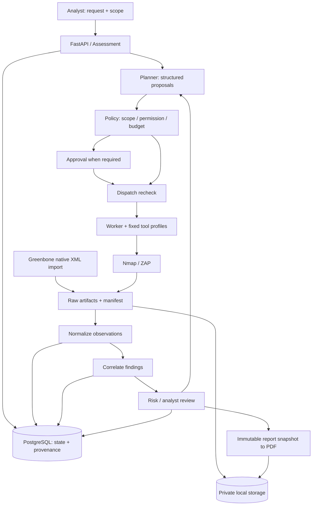

# CoreVAPT — technical recommendations for specification

Status: **research proposal**, not a frozen API/schema or implemented platform. Example fields/endpoints are CoreVAPT choices, not organizer standards. Read with [scanner research](SCANNER_RESEARCH.md), [standards/agent research](STANDARDS_AND_AGENT_RESEARCH.md), and [requirements matrix](REQUIREMENTS_MATRIX.md). English translation: **2026-11-02**; historical external-source checks were not rerun.

## 1. Preferred architecture

One monorepo, a modular monolith backend, and a separate worker sharing the codebase. PostgreSQL owns facts/state; a private local filesystem stores artifacts/reports. Start with HTTP polling for progress. The worker controls scanner processes/containers. A broker is unnecessary for the MVP if job lifecycle and crash recovery are explicit.

The diagram shows responsibilities; it does not require separate approval for every baseline request. Policy returns permit under existing ROE, require approval, or deny. Approval cannot legitimize an out-of-scope action.

### Why a separate worker?

FastAPI `BackgroundTasks` runs after a response; its documentation suggests separate-process tools for heavy work. It does not provide CoreVAPT's durable job contract. **Design inference:** long-running scanners, cancellation, and API restarts favor a separate worker. [FastAPI background tasks](https://fastapi.tiangolo.com/tutorial/background-tasks/).

Use a job/`tool_executions` table with a short transactional claim, lease/heartbeat, attempt ID, and conditional state transitions. PostgreSQL documents `SKIP LOCKED` for contention avoidance in queue-like tables; this is a claim mechanism, not a complete durable queue. [PostgreSQL SELECT](https://www.postgresql.org/docs/current/sql-select.html).

Do not hold a DB transaction throughout scanning. Give requests/tasks/workers separate sessions; SQLAlchemy specifies Session per thread and AsyncSession per task. [SQLAlchemy concurrency](https://docs.sqlalchemy.org/en/20/orm/session_basics.html#is-the-session-thread-safe-is-asyncsession-safe-to-share-in-concurrent-tasks).

Expired leases do not prove a scanner never ran. Reconcile receipts/PIDs/tool job IDs after crashes; use `execution_unknown` when uncertain. Artifact reparsing differs from automatically repeating a scan.

## 2. Interfaces and ownership across eight modules

Following `codebase-design`, interfaces hide tool/storage details while making invariants, ordering, and failures explicit. Do not add abstractions without concrete variants.

| Module | Proposed interface | Ownership / invariant |
| --- | --- | --- |
| Assessment | create/get/revise_scope | Target authorization, versioned scope/ROE; revisions do not rewrite history |
| Planner | propose_next(state, evidence_summary) | Proposal/rationale/source references; no execution authority |
| Policy & Approval | evaluate(action, scope, actor); decide(approval) | Versioned decisions, grant/reject/expiry; dispatch enforcement |
| Tool runner | dispatch(action_id); inspect/cancel(execution_id) | Profiles to argv/API requests; timeouts, limits, actual receipts |
| Normalizer | parse(artifact_id, parser_version) | Raw to observations/warnings; raw bytes never modified |
| Correlation | correlate(observation_ids, rule_version) | Membership, reasons, conflicts; provenance retained |
| Risk | rank(finding_snapshot, context, policy_version) | Stable priority/reasons/unknowns; source severity preserved |
| Report | build(assessment_snapshot_id) | Frozen input rendering, artifact hash, PDF metadata |

Do not force import-only adapters to implement a fictional `execute_live()`. Share ingestion/parsing where useful and declare live capabilities separately. Nmap/ZAP are the proposed execution adapters; Greenbone supports the import seam. These are intended roles, not current working integrations.

## 3. Scope and trust boundaries

Proposed scope contract: authorized lab ID/reference; organizer-approved normalized hostnames/IPs/CIDRs; schemes/ports; exclusions; allowed profiles; rate/concurrency/deadline; validity; approver; version/hash. An entered domain is not authorization evidence.

OWASP SSRF guidance recommends allowlists, address checks, and avoiding redirects that bypass validation. **CoreVAPT application:** exact host matching, IPv4/IPv6 canonicalization, A/AAAA resolution, rejection outside the allowlist, and validation of actual destinations. Do not use naive hostname suffix matching. [OWASP SSRF prevention](https://cheatsheetseries.owasp.org/cheatsheets/Server_Side_Request_Forgery_Prevention_Cheat_Sheet.html).

One URL precheck cannot constrain all subsequent crawl/DNS/redirect traffic from an external scanner. **Feasible MVP proposal:** fixed authorized lab hosts/ports, scanner context, and an egress allowlist or protocol-appropriate scope-enforcing proxy, including DNS/IPv6. Without enforcement, do not enable unrestricted crawling or claim strict scope from prompts alone; disclose unmet acceptance.

Keep API/DB/credentials outside target-controlled data boundaries. Only workers access scanner APIs; never send keys to the frontend. Do not mount the Docker socket into an agent. If containers are used, a fixed host launcher controls them. Backend/worker environment supplies credentials; exclude them from prompts/PDFs.

Backend-authenticated identity must own approval; do not trust client-supplied `reviewer`. A simple server-side analyst account and private/local demo may suffice without multi-tenant SSO. An unauthenticated public Approve button does not demonstrate reliable human control.

## 4. Bind approval to the action

The proposed action envelope contains action/assessment IDs, selected tool/profile, normalized targets, parameters, scope version/hash, budget, rationale/evidence IDs, and proposer. Canonical serialization produces the action hash.

Approval stores that hash, actor, decision, timestamp, expiry, rationale, and execution-outcome reference. Before dispatch, recheck current scope, expiry, permissions, parameter hash, and grant status. Changed parameters cannot reuse a grant. Side-effecting retries require a defined policy rather than unlimited implied authority.

Policy outputs are `permit`, `require_approval`, and `deny`. UI cannot override denial. Audit blocked proposals too. Approving an unsupported action must not create an execution.

Demonstrate what is actually authorized: a bounded validation profile on the organizer-approved lab, request → pending → reject/approve → genuine dispatch/outcome. If active/offensive execution is not authorized, demonstrate a blocked proposal with “not executed”; do not imply a Metasploit integration. A labeled fake runner can test the guard but is not live-validation evidence. Ask the organizer whether a blocked-gate demonstration suffices without active lab permission.

## 5. Data model: required concepts before table counts

### Provenance chain

`assessment/scope → decision/action → execution/import → raw artifact → scanner observation → canonical finding/membership → priority/review → report snapshot`.

Logical additions to the original seven-table proposal:

- **Decision/action records:** plan, selected profile, concise rationale, policy result, action hash, and grant.
- **Artifacts:** raw bytes/URI, checksum, size, content type, source, collected/imported timestamps. An extended evidence table is acceptable if an artifact need not belong to one finding.
- **Observations:** original records linked to execution/artifact/rule/asset/location, including service discovery and non-vulnerability information.
- **Finding membership:** many observations per canonical finding with enforced references, rather than an unconstrained JSON list.
- **Report snapshots:** an immutable manifest artifact with metadata can suffice; complex tables are optional.

No data warehouse or event-sourcing framework is proposed. Preserve source records during merging. Use JSONB for tool-specific payload/metadata and relational columns for queried/enforced IDs, foreign keys, states, and uniqueness.

### Easily omitted fields

| Group | Proposed contract |
| --- | --- |
| Asset identity | assessment_id, asset_id, normalized host/IP; transport/port service identity; sourced/timestamped aliases |
| Observation | observation_kind, source_tool/rule/native_id, execution_id, asset/service, location/method/parameter, raw severity/confidence, mapping version |
| Artifact/evidence | sha256, raw locator (XPath/JSON path/message ID), source scan timestamps, imported_at, redaction, access control |
| Vulnerability | Description, applicability, severity assessments, sourced CVE/CWE/references, evidence IDs, validation state/history |
| Correlation | Observation/canonical finding IDs, rule/version, match reason, disagreements, analyst override |
| Risk | Selected severity source, analyst-sourced exposure/impact, exploitability signals, unknowns, policy version, reason codes |
| Agent | Model ID, prompt version, source IDs, decision ID, allowed actions, proposal, uncertainty, policy result |
| Report | Snapshot ID/time, included execution/finding versions, checksum, template version, limitations |

Nmap `service.conf`, ZAP confidence, and Greenbone QoD differ in scale and meaning. Do not collapse them into one float called probability of correctness. A declared confidence label plus raw values is sufficient for the MVP; statistical calibration is advanced work.

Scanner `observed_at`, CoreVAPT `ingested_at`, analysis `analyzed_at`, and report `generated_at` differ. Label old imports historical; matching target strings do not prove identical asset state.

### States

Execution: `queued/running/succeeded/partial/failed/timed_out/cancelled/execution_unknown`; policy denial is not scanner failure. Assessment aggregation is separate; a failed scanner may still yield a partial report.

Validation: `observed/suspected/confirmed/rejected/needs_review` with method, evidence IDs, reviewer, and timestamp. Confirmed means supported under a defined method, not necessarily exploited. Source disagreement is not automatically a false positive; record analyst disposition/reason separately.

## 6. Explainable MVP correlation

First deduplicate exact same-tool/run/native-ID records; then apply compatible cross-tool rules. Candidate keys use asset/service, vulnerability/rule equivalence, and location, checked against time and evidence. Similar titles only propose review.

A shared CVE on different assets/services represents distinct affected instances. Web path/method/parameter can define distinct instances. Do not blindly collapse query values; redaction must not make distinct locations identical.

An Nmap HTTP observation provides context for ZAP; it is not a duplicate alert. Header findings may merge when endpoint/response context and rule equivalence match. A host-wide Greenbone alert without endpoint may remain `related` until more evidence exists.

Proposed correlation states: `exact_duplicate`, `correlated`, `related`, `conflicting`, `unmatched`. Automerge only deterministic matches; review ambiguity. If actual lab output lacks overlap, use genuine captured fixtures with disclosed provenance for correlation. Do not promise Nmap/ZAP/Greenbone overlap in advance.

Minimum false-positive triage: analyst `needs_review/accepted/rejected` with rationale/evidence, contradictions, and missing preconditions. Defer calibration, embeddings, and advanced inference. Define precision on a labeled evaluation set; an LLM judge alone is not ground truth.

## 7. Proposed API surface for a later specification

| Group | Actions |
| --- | --- |
| Assessments | Create/list/detail; versioned scope update; natural-language request |
| Plans/actions | Propose/get plan; review action; start/cancel workflow; poll timeline |
| Executions/imports | Status/detail; bounded cancellation; native-file upload and parse result |
| Findings | List/filter; detail/provenance; review/correlation disposition |
| Approvals | Pending list; grant/reject; outcome trace |
| Evidence/reports | Authorized preview/download; create/get/download snapshot PDF |

Where appropriate, asynchronous mutations return `202` plus job ID. Use idempotency keys for execution/import/report requests. Proposed responses: `409` conflict/stale state, `403` policy/permission denial, `413` oversized input, `415` unsupported media, and `422` invalid contract. These are proposed HTTP choices, not existing endpoints.

No arbitrary command, SQL-query, or unrestricted model database-access endpoint. The runner accepts a policy-authorized action ID; UI never sends argv.

## 8. Imports, storage, and PDF

Store raw bytes before parsing: temporary file → atomic rename → DB manifest reference, with checksum over original bytes. Bound size, depth/records, and parse time; reject client-supplied storage paths. Track orphaned files after DB commit failure for reconciliation; filesystem and DB do not share one transaction.

Use safe XML parsing and resource limits. Nmap may legitimately declare a DOCTYPE; declaration alone is not an attack. Disable external DTD/entity retrieval, pin local schemas when needed, retain raw bytes, and define the declared-DTD policy. [OWASP XXE prevention](https://cheatsheetseries.owasp.org/cheatsheets/XML_External_Entity_Prevention_Cheat_Sheet.html).

Proposed PDF path: HTML template/renderer with analyst review before release. WeasyPrint supports this but requires dependencies such as Pango and warns about untrusted content. Pin renderer/fonts, escape scanner text, block arbitrary file/URL fetches, and limit rendering resources. [WeasyPrint first steps](https://doc.courtbouillon.org/weasyprint/stable/first_steps/).

Render a report snapshot, not changing queries page by page. Evidence references need IDs/hashes/locators and controlled URLs or a redacted appendix. Demo-localhost links will not automatically work for judges later. The sample PDF must be independently readable.

## 9. Decisions to settle before implementation

1. Lab/ROE and permitted baseline/validation activities.
2. Packaged ZAP baseline versus daemon API: one primary orchestration method.
3. Specific Greenbone native export/provenance and fallback-adapter decision deadline.
4. LangGraph versus custom state machine: one workflow source of truth.
5. Observation/finding/artifact/action schemas, including difficult identity/state examples.
6. Analyst authentication, approval binding, and worker/network enforcement.
7. Transparent priority policy; live enrichment is optional.
8. PDF renderer/template, metric units, model provider/cost/data policy.

These inform WP-01–WP-04. They do not require freezing every implementation detail before a vertical slice.

## 10. Model selection and cost control

No provider/model is selected by this research. Use an accessible model API and compare identical evidence summaries for valid structured output, correct references, fact/inference separation, permitted action selection, missing-data handling, latency, and observed cost. General pentest benchmarks do not establish suitability for CoreVAPT planning.

Pydantic validates contract structure/values and generates JSON Schema; it cannot prove a security claim. A syntactically valid but nonexistent evidence ID requires semantic rejection. [Pydantic models](https://docs.pydantic.dev/latest/concepts/models/).

Record model/version when available, artifact IDs, prompt version, token usage, latency, and errors for each call. Apply assessment budgets, timeouts, and retry limits. Send minimal redacted evidence and review the selected provider's retention/data terms. Verify prices/quotas when choosing a provider; call count alone cannot estimate cost.

Estimate each call as `(input tokens × input unit price + output tokens × output unit price)`, respecting provider units and adding applicable cache/tool charges. State that infrastructure/scanner costs are excluded. Model failure can pause or partially complete the workflow; label deterministic fallback explicitly.

## 11. PentestGPT/Fennec additions — 2026-11-02

The [pinned-source comparison](UPSTREAM_ARCHITECTURE_COMPARISON.md) distinguishes observed patterns from CoreVAPT proposals. Retain the stack and eight responsibilities; clarify:

- Typed proposals undergo semantic checks for source IDs, scope/state revision, profile, and budget before state mutation/dispatch.
- PostgreSQL owns canonical state; bounded model context is a projection.
- Each next action addresses a concise question/hypothesis with basis IDs, expected evidence, and `done_when`. Basic adaptive branching remains P0.
- Attempts/receipts support recovery; model summaries or expected output names cannot replace captured artifacts.
- Reserve finalization budget for partial reports and limitations when coverage remains incomplete.

Defer full hypothesis trees, specialist agents, large knowledge registries, and SSE. Basic cross-tool correlation, approval at dispatch, and evidence traceability remain P0. Do not transfer full-access runners, arbitrary shells, or optional hypothesis review into CoreVAPT as enforcement.
