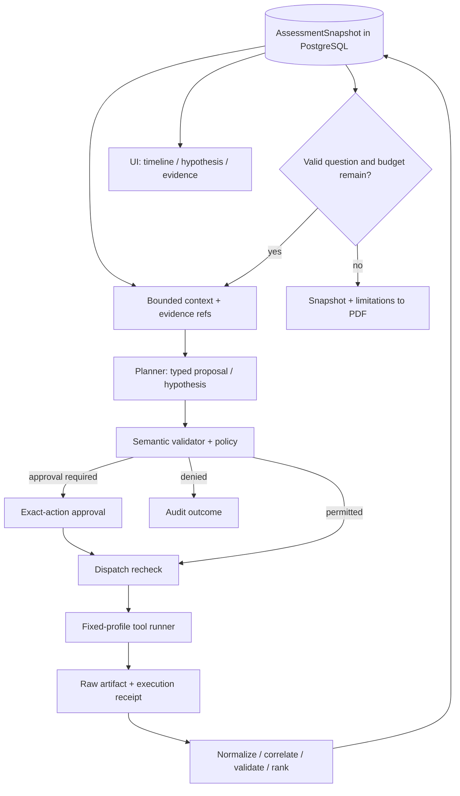

# PentestGPT × Fennec — useful additions for CoreVAPT

Additional research: **2026-11-02**. Method: clone pinned source into `/tmp/corevapt-upstream-research`, inspect entrypoints, orchestration/state/execution, and documentation. No dependencies installed, agents/models/scanners executed, or upstream tests run. This is a **historical static source review**, not a comprehensive audit/benchmark; English translation did not rerun it.

## 1. Project conclusion

**Useful ideas can strengthen the existing modular monolith and eight responsibilities.** Prioritize typed plans with semantic checks, revisioned canonical state, evidence receipts, bounded hypotheses with stop conditions, and reserved finalization budget. These address observe → decide → execute → report failures without a large multi-agent platform.

Recommendations are proposed CoreVAPT designs, not implemented features or new organizer requirements. Use the [requirement matrix](REQUIREMENTS_MATRIX.md) to distinguish requirements from solution choices.

## 2. Source snapshots and confidence

| Repository | Reviewed commit | Caveat |
| --- | --- | --- |
| PentestGPT | `e8b1bb77d1ac00329675cec3b060aba971ec1ac8` | Maintained nested framework, legacy, and compatibility copies are different generations |
| Fennec | `e56c8c1c5cbeea93b719f8001ea136c6b15c7055` | OSS only; hosted service unverified |

Detailed sources: [PentestGPT](PENTESTGPT_ARCHITECTURE.md), [Fennec](FENNEC_ARCHITECTURE.md). Clone metadata: [upstream snapshots](sources/upstream-snapshots.json). Branches may change; conclusions apply to pinned commits.

## 3. The architectures address different problems

### PentestGPT: validate proposals before canonical-state mutation

The nested framework uses `SupervisorDecision`, plan/execution compilers, durable memory, and one task per loop. It validates revision and basis observation IDs before committing plans. [Plan language/compiler](https://github.com/GreyDGL/PentestGPT/blob/e8b1bb77d1ac00329675cec3b060aba971ec1ac8/pentestgpt_agent/src/pentestgpt_agent/plan.py#L157-L221).

Execution compilation checks task/attempt/trace identity and captured receipts; fallback/truncated/unresolved states can downgrade done to progress. [Execution validation](https://github.com/GreyDGL/PentestGPT/blob/e8b1bb77d1ac00329675cec3b060aba971ec1ac8/pentestgpt_agent/src/pentestgpt_agent/execution.py#L271-L380).

**Lesson:** schema-valid JSON is insufficient to modify authoritative data. Validate assessment-owned evidence IDs, current revision, permitted profiles, and actual artifact existence. A returned execution receipt does not establish a correct vulnerability claim.

### Fennec: hypotheses are work units; routers are deterministic

Python orchestration processes outcomes and selects next work; the manager owns queues, dependency outputs, and status. [Router](https://github.com/Fennec-AI/Fennec/blob/e56c8c1c5cbeea93b719f8001ea136c6b15c7055/src/graph/role_based_graph.py#L44-L103), [Hypothesis manager](https://github.com/Fennec-AI/Fennec/blob/e56c8c1c5cbeea93b719f8001ea136c6b15c7055/src/orchestration/hypothesis_manager.py#L38-L133).

**Lesson:** models can propose investigation questions while code determines executable work. A single planner plus deterministic runner can use this principle without four specialist agents.

## 4. Five MVP design additions

| Addition | Source inspiration | CoreVAPT location | Concrete benefit | Priority |
| --- | --- | --- | --- | --- |
| Typed plan and semantic validation | PentestGPT | Planner/Policy | Reject invented evidence, stale plans, unregistered actions | P0 |
| Canonical state and attempts/receipts | PentestGPT | Orchestrator/DB/runner | Reconcile recovery rather than blindly rerun scans | P0 |
| Small hypothesis with `done_when` | Both | Planner state | Each action answers a question with a stop condition | Minimal P0; tree P1 |
| Bounded evidence-based context | Both | Planner input builder | Avoid repeated raw dumps while retaining full sources | Simple P0 |
| Reserved finalization budget | Fennec | Orchestrator | Produce partial reports/limitations near quota | P0 |

These refine existing interfaces/invariants; they are not five new modules/dependencies. Earlier research already included durability, receipts, and budgets; this review clarifies contracts/acceptance.

### 4.1. A plan is a proposal, not a command

Proposed `ActionProposal`: assessment ID, state revision, optional hypothesis ID, action/profile enum, normalized target, basis observation IDs, expected output, `done_when`, concise rationale, and requested budget. Exclude generated shell commands.

Validate contract → assessment/evidence ownership → dependencies/coverage → scope/permission → duplication/budget → approval binding. Recheck at dispatch. Scope/state changes can invalidate proposals; show stale plans rather than silently execute them.

No general compiler framework is required. One Python validator at the execution seam may suffice for three adapters. P0 means a necessary invariant, with MVP-sized implementation.

### 4.2. Canonical state differs from chat history

Proposed `AssessmentSnapshot`: scope/revision, coverage, normalized observations, canonical findings, completed/blocked actions, pending approval, remaining budgets, and unresolved questions. PostgreSQL is authoritative; prompts are bounded projections.

Actions have attempts, execution identity, profile version, status, and artifact/receipt references. Only the current valid attempt may commit results. Reconcile crashes between dispatch and receipt against tool/process state; unresolved outcomes become `execution_unknown` rather than blind retry.

Keep PostgreSQL; no copied SQLite kernel or event-sourcing framework is needed. History must support audit/recovery. A journal/model trace does not replace raw scanner artifacts.

### 4.3. Small hypotheses make reasoning demonstrable

Example defensive question, not a vulnerability claim: **“An HTTP service is observed; does the in-scope endpoint lack security headers under the permitted profile?”**

A small record contains `hypothesis_id`, `claim`, `basis_ids`, `required_capability`, `expected_evidence`, `done_when`, status, and outcome/reason. Start with a flat list or a few dependencies; defer full attack trees, graph databases, and dependency engines.

Example:

1. Nmap observation establishes an in-scope HTTP service.
2. Planner proposes the relevant ZAP profile with an evidence objective.
3. Policy checks authority; runner executes and captures genuine output.
4. Parser produces observations; analyzer compares them with the question.
5. Missing evidence yields `inconclusive/needs_review`; sufficient evidence supports the defined validation method, not linguistic certainty.

Absent HTTP or an already-completed profile prevents repeated ZAP calls. `done_when` must be checkable against normalized data/coverage, not prose the model declares satisfied.

Keep execution success, hypothesis outcome, finding validation, and assessment coverage separate. Successful scanning does not establish a true hypothesis; unconfirmed findings do not establish a safe asset.

### 4.4. Bounded context without lost evidence

Fennec middleware shortens older ToolMessages while retaining tool-call pairing metadata. [Context middleware](https://github.com/Fennec-AI/Fennec/blob/e56c8c1c5cbeea93b719f8001ea136c6b15c7055/src/middleware/truncate_tool_outputs.py#L145-L178).

**Proposed application:** store raw first; send summarized facts, source IDs, uncertainty, and bounded excerpts. Version summaries and reference originals; the model cannot modify raw bytes. Additional reads use bounded, authorized artifact interfaces rather than unrestricted filesystem access.

Order input by scope/permissions → relevant observations → previous outcomes → unresolved questions → allowed catalog/budget. A single assessment demo does not need a vector database or long-term memory.

### 4.5. Reserve budget for conclusions

Fennec middleware removes regular tools and directs structured finalization near its model-call limit. [Finalize middleware](https://github.com/Fennec-AI/Fennec/blob/e56c8c1c5cbeea93b719f8001ea136c6b15c7055/src/middleware/finalizeBeforeModelLimitMiddleware.py#L55-L89).

**Proposed application:** `running → finalizing → partial/completed`. At a threshold, stop new scans, freeze assessment state, and reserve quota for summaries, uncertainties, and sourced remediation. If the model quota is exhausted, deterministic templates still export facts/limits with an explicit fallback label.

Model-call limits do not replace scan deadlines, tool/token/money budgets. Do not copy upstream call counts without measurement.

## 5. Useful ideas to defer or simplify

- **Capability registry:** typed inputs/outputs/evidence/profiles aid planning. A small static catalog is sufficient for the MVP; Markdown knowledge neither registers executable capabilities nor grants authority.
- **Shared typed events:** DB transitions/outcomes and polling suffice for P0; SSE can improve UX once the main path works.
- **Hypothesis trees:** useful with real dependencies; a flat queue suffices for discovery/web/import.
- **Model roles:** distinct planner/analyzer/report prompts can share one model. Add agents/models only for measured error/context/cost needs.

Fennec can drop slow SSE subscribers and stores jobs per process; UI streams cannot be the audit source of truth. [Event fanout](https://github.com/Fennec-AI/Fennec/blob/e56c8c1c5cbeea93b719f8001ea136c6b15c7055/src/api/events.py#L28-L44), [Job store](https://github.com/Fennec-AI/Fennec/blob/e56c8c1c5cbeea93b719f8001ea136c6b15c7055/src/api/job_store.py#L1-L8).

## 6. Patterns not to transfer unchanged

| Upstream design/interpretation | Limitation for this project | Required CoreVAPT property |
| --- | --- | --- |
| General shell/full-access execution | Prompt/plan scope does not enforce each tool destination | Fixed profiles, executor policy, network scope |
| Optional hypothesis review | Question review is not approval of exact actions; tools may run around it | Action/profile/scope approval at dispatch |
| Process-local job state | Restart loses state/audit and makes resume ambiguous | PostgreSQL and receipts |
| LLM verdict/rich text treated as confirmed | Rich structure does not validate correctness | Source evidence, criteria, uncertainty |
| Expected outputs treated as existing | Can unblock dependencies without captured artifacts | Actual artifact/observation references |
| Hosted/dashboard claims as OSS runtime proof | Marketing/seeded demos differ from execution | Honest modes/fixtures and verified outcomes |
| Full Kali/multi-agent stack | Expands solo build/resources/scope | Three bounded adapters and one worker |

Detailed entrypoint/permission and review/execution sources remain in the individual reports. These limitations do not mean either repository lacks value or cannot operate safely in its own environment.

Specific counterpattern: Fennec adds expected output names following a vulnerable verdict. [Source](https://github.com/Fennec-AI/Fennec/blob/e56c8c1c5cbeea93b719f8001ea136c6b15c7055/src/orchestration/hypothesis_manager.py#L178-L203). CoreVAPT must not treat names as evidence; subsequent decisions must reference collected artifacts/observations. This was inferred from code, not reproduced at runtime.

## 7. Proposed architecture after the additional research

This refines the proposed stack. Supported imports enter artifact/normalization directly; do not fake live execution. Human finding review before reporting remains separate from pre-action approval.

## 8. Updates for WP-01–WP-04

**WP-01:** define success as evidence-supported decisions and reduced analyst effort; include missing evidence, stale scope, and exhausted budget. Hypothesis UI is useful only if it improves understanding.

**WP-02/03:** consider `propose_next(snapshot)`, `validate_proposal(proposal, snapshot)`, `dispatch(authorized_action_id)`, and `commit_execution(receipt, observations, expected_revision)`. Names are proposals; avoid pass-through layers solely to match a diagram.

**WP-04:** add basis IDs, `done_when`, revision, attempt ID, receipt/artifact references, and finalization reason. Hypotheses can initially use metadata/JSONB instead of a general DAG schema.

**UX/demo:** one card can show question → observed source → proposal → policy/approval → outcome → evidence, communicating more than many transcript-only screens.

## 9. Additional acceptance cases — not run

1. Nonexistent/cross-assessment observation ID → reject proposal without dispatch.
2. Stale revision or changed target/profile after approval → stale/rejected, preserving original proposal/audit.
3. Crash recovery reconciles receipts; unknown outcomes remain explicit without blind scan replay.
4. Claimed hypothesis completion without captured evidence → inconclusive/needs_review, never a published confirmed vulnerability.
5. Truncated context still traces raw/coverage; raw data must be stored before pipeline truncation.
6. Exhausted budget with pending hypotheses → partial report of untested areas, not a safe verdict.
7. UI reconnect/event loss → reload durable state; audit/execution outcomes survive subscriber loss.

Only implementation and acceptance can establish improved reliability or lower false positives. This research measured no comparative quality across the three systems.
