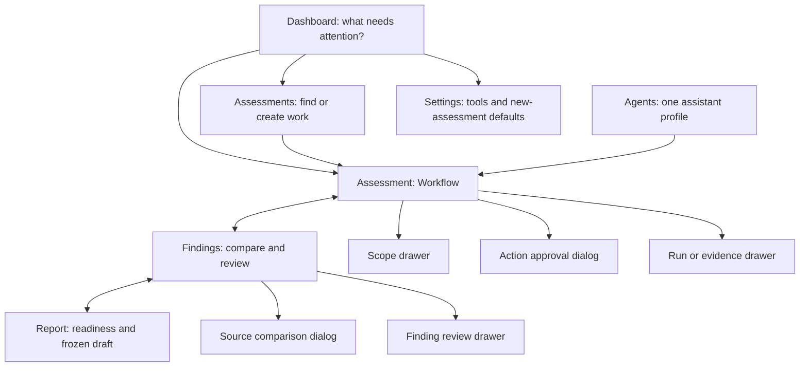

# CoreVAPT — analyst dashboard and simple page model

Current revision: **V6.4**, 2026-11-02. The user approved the [V6.2/V6.3 merge](FRONTEND_V6_2_V6_3_MERGE_RESEARCH.md): visible lifecycle, one assistant profile and consistent header creation. See [fresh verification](FRONTEND_V6_4_VERIFICATION.md). The original standards research and S01–S07 scenarios are retained below; current page composition is updated explicitly.

User request: add a dashboard, use business-analysis/security perspectives, reduce unnecessary pages, use contextual popups, clarify configuration and document demo scenarios before building the frontend. This revises the V6.2/V6.3 information architecture; it does not introduce backend/scanner/model implementation.

## 1. Product and user decisions

The primary user is an authorized analyst coordinating an assessment. The immediate business questions are: what needs my decision, which assessment should I resume, what was actually observed, and what can a report responsibly conclude? A dashboard is useful only if it leads to those tasks.

The secondary reader is a reviewer/report recipient. They need a scoped, traceable summary, not all the analyst's controls. Use executive/technical report views rather than building a separate executive portal.

Success means fewer navigation choices without hiding scope, approval, failures, uncertainty or provenance. Reduced page count alone is not evidence of usability. No human usability study or time-saving benchmark is claimed.

## 2. Primary sources and application

Sources accessed on 2026-11-02. The mappings below are CoreVAPT design decisions, not source requirements to build these exact pages.

| Source | Type | Applied decision | Verification boundary |
| --- | --- | --- | --- |
| [WCAG 2.2](https://www.w3.org/TR/WCAG22/) — 1.4.3, 1.4.10, 2.4.3, 2.4.7, 2.4.11, 2.5.8, 3.2.3, 3.3.1/2, 4.1.3 | Accessibility standard | Consistent navigation, visible/ordered focus, text statuses, labelled fields/errors, reflow and accessible status updates. Target 44 px for primary/touch controls; minimum target/spacing considerations follow 2.5.8 | Targeted browser checks; no full WCAG conformance audit |
| [WAI-ARIA APG modal dialog](https://www.w3.org/WAI/ARIA/apg/patterns/dialog-modal/) | Authoring pattern | Accessible title, focus inside, inert background, Tab containment, Escape/visible close and logical focus return | Keyboard/browser checks, not full assistive-technology testing |
| [Carbon dashboard guidelines](https://www.carbondesignsystem.com/building-blocks/data-visualization/dashboards) | Design-system guidance | Put decisions before totals, limit metrics and use consistent semantic colors. Show current-state counts from actual local records | Formula/fixture checks; no fabricated trends or risk score |
| [Carbon modal guidelines](https://www.carbondesignsystem.com/building-blocks/core/components/modal/guidelines) | Design-system guidance | Use a dialog for a short focused decision or infrequent edit. Keep repeated work on the page. A broad ongoing workflow should not live in a popup | Single-overlay inspection and return-path checks |
| [NN/g progressive disclosure](https://www.nngroup.com/articles/progressive-disclosure/) | UX principle | Show common tasks first; reveal raw logs, advanced scope fields and technical payload on demand | Review field/page inventory; no onboarding wizard required |
| [GOV.UK task list guidance](https://design-system.service.gov.uk/components/task-list/) | Design-system guidance | Simplify before adding task navigation; use plain task/status labels. Assessment dependencies are not a freely reorderable checklist | Lifecycle indicators describe state; they are not six required pages or completion percentages |
| [GOV.UK validation pattern](https://design-system.service.gov.uk/patterns/validation/) | Form-design guidance | Preserve entered values and give actionable field/summary feedback. Separate invalid input from permission/policy denial | Defaults/scope validation and focus checks; not adoption of the complete GOV.UK component library |
| [NIST SP 800-115](https://csrc.nist.gov/pubs/sp/800/115/final), sections 6–8 and Appendix B | Security-assessment guidance | Keep planning/ROE, execution/analysis and reporting responsibilities explicit. Scope remains assessment-specific; defaults do not authorize testing | Source-aligned design; no certification or live security validation |
| [Organizer PDF](../../1.pdf), §§3, 5–7, 10, 13 | Project requirements | Preserve adaptive evidence-led planning, three integration/import target, human approval, source provenance and six report sections | Frontend scenarios do not satisfy live integrations or AI accuracy |

The standards address accessibility/process; the design-system and UX articles supply guidance. No source mandates a particular number of pages, popup use or color palette. Those choices follow the analyst tasks and current MVP scope.

## 3. Options considered

| Option | Benefit | Cost | Decision |
| --- | --- | --- | --- |
| Dashboard + Assessments; three views inside an assessment; contextual drawers | Clear starting point, few primary destinations, repeated review remains visible | Requires explicit mapping from six business stages to three working views | V6.3 baseline; V6.4 adds Agents and restores visible orientation |
| Add Dashboard and keep all six V6.2 stages as separate views | Smaller code change, visible process | More switching between plan/run and analysis/review; configuration becomes another destination | Retain stage meanings, reduce navigation |
| Put everything in chat and popups | Very small navigation | Hides run monitoring, repeated triage and report reading; context loss between dialogs | Not selected |

## 4. Page map and responsibilities

**Dashboard, Assessments and Agents** are the three permanent primary destinations. **Settings** opens a footer drawer. The selected assessment is contextual, with its own header selector rather than another sidebar item. **New assessment** appears once in the Dashboard/Assessments/open-assessment header, including empty states, and never in the sidebar or mobile menu. Agents offers **Open workflow** for the selected assessment.

Page responsibilities:

| Surface | Purpose / first visible information | Primary task | Secondary details |
| --- | --- | --- | --- |
| Dashboard | Cross-assessment decisions and recent work | Open the next attention item or create an assessment | Current-state counts with explicit units; source notice |
| Assessments | Search and resume all assessments | Open/create | State, target, next action; no second dashboard |
| Agents | One Assessment assistant: role, mode, model, capabilities, limits and selected-assessment activity | Understand authority; open the selected assessment's Workflow | Tools/limits or scope details; no model selector, credentials, agent creation or workflow builder |
| Workflow | Current task with reason, evidence basis, required decision and expected result; request, compact plan and latest attempts | Review proposal, explicitly generate a proposal or separately simulate an approved action | Scope, tool rationale, full attempt logs, past decisions and conversation; mobile assistant opens contextually from the task |
| Findings | Ranked candidate register with review status and source count | Review a finding | Source overlap comparison, evidence register, audit, raw fixture and risk context |
| Report | Readiness, limitations and one frozen draft | Review/generate draft; inspect executive/technical view | Six required sections, immutable references, sample exports |

The read-only lifecycle **Scope → Plan → Collect → Analyze → Review → Report** stays visible on all three assessment views. Scope/Plan/Collect map to Workflow, Analyze/Review to Findings, and Report to Report. Collect includes execution and result ingestion; it does not rename backend run/import states. The lifecycle is a status overview, separate from view navigation; no completion percentage or forced wizard is implied. Evidence, request/scope changes and a new retry proposal can return the current task to Plan.

The header identifies the same assistant as Agents; **View assistant** opens a short summary. Preview states show **Demo · deterministic**, **Model: Not connected** and **AI planning: In development**. Clarification messages preserve request revisions and grants. **Edit request**, **Generate plan**, approval and run start are distinct actions. Next-step explanations capture the assessment/request/task basis at send time, including if the analyst switches assessment while waiting.

## 5. Dashboard counts and attention semantics

All numbers are derived from state and carry scenario labels. No chart is added without a real series, time window and analyst decision it supports.

- **Awaiting approval:** Pending actions whose local policy remains valid. Stale/expired/blocked proposals are listed as blocked work, not actionable approvals.
- **Run issues:** latest relevant attempt per assessment/target/profile in failed, timed_out, partial or execution_unknown state. A failed attempt superseded by a successful retry remains history and leaves this queue. Unknown requires reconciliation before retry.
- **Findings to review:** canonical, non-merged candidates with disposition needs_review. Service observations and rejected candidates are excluded; accepted does not mean technically confirmed.
- **Report drafts:** count of current local frozen snapshots, not issued/client-ready PDFs. A later review can mark a draft stale.

Attention rows include assessment identity/target, the reason for attention and one task-specific CTA. A dashboard CTA opens the correct assessment before a decision drawer. Do not approve a target-less global item. Empty counts show 0; unknown risk or coverage does not become 0. A blank workspace invites a first assessment rather than showing fake activity.

## 6. Popup/drawer rules

Use one overlay at a time. Opening raw evidence from a finding replaces its drawer and offers a contextual Back action; the finding rationale is retained. Do not stack modal scrims. Escape exits the active overlay and returns focus to a live invoking control or logical workspace control.

Small dialog: create assessment, approve/reject one action, acknowledge draft replacement, compare one source pair. Side drawer: scope form, finding review, evidence/raw bytes, tool/default configuration or an attempt detail. Long report reading, ongoing chat/run monitoring and repeated finding review remain attached to the assessment workspace.

Short dialogs have an explicit close/cancel and one clear primary action. Disclosure sections hold advanced parameters, raw payload, complete logs and decision history. Opening/closing details cannot approve, dispatch, merge or mark a finding confirmed. User-entered reasons survive local detail navigation. Repeated floating buttons must not cover focused controls.

## 7. Configuration boundaries

| Kind | Location / fields | Rules |
| --- | --- | --- |
| Workspace defaults | Settings → New assessment defaults: default TCP ports, max requests/s, run deadline | Session-only preview; apply only to newly created assessments. Defaults are not permission or current scope. Validate bounded numbers and preserve invalid input |
| Assessment authorization | Scope drawer: target/IP, ROE, allowed ports; exclusions/rate/deadline in advanced section | Save creates a scope version, invalidates old proposals/grants and requests cancellation of affected simulations |
| Action parameters | Approval dialog, read-only exact target/profile/ports/budget/evidence/expiry | No shell/CLI text box; edits require a new proposal and decision |
| Integrations | Settings → Tools: seven tool modes/limitations | Three Planned and four Unsupported remain truthful; planned capability copy says In development. No fake connect button or fabricated health |
| Model/provider credentials | Backend configuration, outside this HTML | No API keys/passwords in browser localStorage, no editable model knobs without a connected capability |

No generic settings catalogue, notification preferences, theme builder, team administration, custom workflow editor, charts, report-template editor or scanner parameter playground is introduced.

## 8. Demo scenarios

| Scenario | Steps | Observable result / boundary |
| --- | --- | --- |
| S01 Resume and decide | Dashboard → awaiting approval → inspect scope/basis → approve → start simulation separately | Correct assessment context; approval alone creates no run |
| S02 New assessment | Dashboard → create with target/IP/ROE/request → review plan → generate bounded discovery proposal | Empty data, inherited defaults and explicit authorization; no prefilled finding |
| S03 Complete evidence flow | Approved ZAP success → Findings → compare historical/current source → review risk/disposition → Report | Source members retained, /admin distinct, six-section draft with synthetic labels |
| S04 Failure recovery | Simulate timeout/unknown → Dashboard run issue → inspect logs/reconcile → new retry proposal+approval → successful replacement | Previous attempt immutable, no auto retry; issue count resolves after replacement success |
| S05 Change defaults vs scope | Change defaults → inspect existing assessment unchanged → create new assessment with defaults → edit current scope separately | Defaults do not mutate existing authorization; scope revision invalidates previous approval |
| S06 Review correction | Mark candidate false positive → count drops from needs-review queue → freeze draft → change review | Evidence retained, excluded appendix and frozen snapshot unchanged |
| S07 Honest limits | Tools status or native import → inspect readiness | Unsupported/planned remains explicit, no claim of three working integrations or real AI |

For later human usability evaluation, ask representative analysts to complete S01, S02 and S04 without coaching, then record navigation errors, lost context, completion time and whether approval/run, severity/risk and synthetic/actual distinctions were understood. These are proposed evaluation tasks, not observed results.

## 9. Acceptance and boundary

V6.4 preserves action/evidence/attempt/risk/snapshot invariants with the approved page composition. Its [verification record](FRONTEND_V6_4_VERIFICATION.md) covers current-state counts, cross-assessment context, clarification/request separation, retry-task precedence, one creation control, assistant metadata, visible lifecycle, defaults, overlays, keyboard, reflow and print. The merge report's local M01–M09 scenarios supplement S01–S07; they are not the platform acceptance IDs. No standards compliance, scanner integration, AI accuracy, production persistence or human usability improvement is inferred from browser tests.
