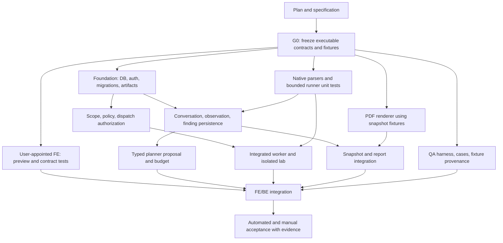

# CoreVAPT — Master Implementation Plan

> **For agentic workers:** REQUIRED SUB-SKILL: Use superpowers:subagent-driven-development or superpowers:executing-plans to implement this plan task-by-task. Steps use checkbox (`- [ ]`) syntax for tracking.

**Goal:** Implement a local platform whose frontend is developed in parallel by the user's appointed agent, with an evidence-backed backend and verification at each gate.

**Architecture:** FastAPI modular monolith, PostgreSQL, a separate worker, and private local artifacts. The frontend follows the [current V6.4 prototype](../../../corevapt_frontend_v6.4.html), HTTP contract, and capability manifest; before backend integration it displays “In development” or a labeled preview. Historical V4 references describe the original planning basis; the removed V4 file is not a dependency.

**Tech Stack:** FastAPI, Pydantic, SQLAlchemy, Alembic, PostgreSQL, Nmap, ZAP packaged baseline, Greenbone XML import, WeasyPrint, Docker Compose; the frontend owner chooses its stack.

**Spec:** [Design](../specs/2026-11-02-corevapt-platform-design.md), [contract v0](../specs/2026-11-02-corevapt-contracts.md).

## Global Constraints

- The user appoints the frontend agent; the coordinator must not replace that choice.
- Preserve V6.1/V6.2/V6.3 and use V6.4 as the current prototype reference.
- PostgreSQL owns canonical state; the model only proposes; the worker rechecks before dispatch.
- Mocks, API health, and prototype browser print do not establish platform E2E verification.
- Planned capability displays “In development”; connection failure is a separate error.
- Shared contracts, migrations, dependency lockfiles, Compose, and application wiring each have one owner.
- All commands/tests in this plan set are **future implementation steps**, not executed results, except separately documented document checks. An unchecked checkbox is not a test result.
- G0 schemas remain draft until executable validation succeeds. Conversation persistence, evidence-linked decision records, complete risk inputs, and separate generic job/tool-execution state contracts must be frozen before consumers implement them.
- Mandatory source: [1.pdf](../../../1.pdf), 10 pages, SHA-256 `cfc55fc52fdecd8b4c65c5eec9217d39335ac4ab92461e869092fde8a33816cc`. Rubric weights: 15/20/15/15/10/10/10/5; no score is guaranteed by a plan or passing local tests.

## 1. Plan set and handoff

| Plan | Responsibility | Assigned role |
| --- | --- | --- |
| [01 Frontend](2026-11-02-01-frontend-handoff.md) | Prototype UX, HTTP adapter, availability, UI tests | User-appointed frontend agent; identity was not supplied in the initial plan |
| [02 Backend](2026-11-02-02-backend-domain.md) | Foundation, authentication, scope, policy, artifacts, conversation, findings, planner | Backend agents by task; coordinator owns shared files |
| [03 Worker/scanners](2026-11-02-03-worker-scanners.md) | Durable worker, adapters/parsers, receipts, isolated lab | Worker/scanner agents |
| [04 Reports/delivery](2026-11-02-04-reports-delivery.md) | Immutable PDF, packaging, Compose, CI/runbooks | Report agent plus integration owner under file ownership |
| [05 Testing](2026-11-02-05-testing-acceptance.md) | Cases, manual procedures, evidence, acceptance matrix | Independent QA agent plus each module owner running its tests |

Coordination by waves, roles, and handoffs: [06 Parallel dispatch](2026-11-02-06-parallel-dispatch.md).

## 2. Parallel workflow and dependencies

Not every task runs simultaneously: schemas/DTOs and semantics stabilize before consumers; foundation precedes DB integration; policy precedes live dispatch. Parsers, the renderer, and frontend preview can use frozen fixtures. Separate successful modules do not establish E2E until exercised together.

## 3. Gates

| Gate | Input | Pass condition | Evidence |
| --- | --- | --- | --- |
| G0 contract | Design + route inventory | Valid OpenAPI; complete request/response schemas for every route; explicit enum/null/error/limits/idempotency; valid fixtures; FE/BE owners confirm mapping | OpenAPI, validator output, route-to-view matrix, contract version |
| G1 foundation | G0 | Fresh+upgrade migrations, authenticated API, assessment isolation, artifact SHA, transactional audit | Integration logs, DB constraints, API cases |
| G2 module | G0/G1 as required | Domain/parser/renderer/frontend preview tests pass; no ownership conflict | Results per suite; mock labels |
| G3 integration | G1+G2 | Actual frontend HTTP, durable worker, grant/deny/stale approval cases, immutable PDF | Full Compose run, receipt/artifact chain, browser logs |
| G4 lab acceptance | G3+authorized lab/native inputs | Live Nmap and ZAP; native Greenbone import with provenance; evidence-backed manual matrix; disclosed failures/limitations | Lab ROE/network proof, tool versions, three integration evidence sets, PDF, manual report |

Missing lab/provider/export prerequisites do not block independent module development at G4. Mark the relevant cases `blocked` and set capability appropriately; never award a live-verified label. Live model acceptance for R01/R03/R13 is separate: a deterministic scenario cannot be labeled live AI.

The PDF's section 9.5 also requires a human-approval demonstration for active validation with a decision/outcome trace. The MVP's two baseline scan profiles do not implement offensive validation. A fake runner or approval-gate test proves control behavior only and leaves that acceptance gap open. Do not add an active validation adapter to P0 without explicit organizer permission, an exact supported lab action, and the corresponding scope, approval, isolation, and outcome evidence.

## 4. Task M0 — prepare delegation

**Files:** Create `contracts/openapi.yaml`, `contracts/examples/*.json`, `contracts/README.md`, `docs/implementation/STATUS.md`, and `.gitignore` when implementation begins. Only the coordinator modifies `README.md`.

**Interfaces:** Consumes design/contract v0; produces versioned executable schemas, route-to-view mappings, ownership ledger, and fixtures for the subplans.

- [ ] Read the spec and R01–R15; map every requirement to an owner/task/test ID in STATUS.
- [ ] Recheck repository state; if Git is still absent and setup is authorized, initialize it and ignore `.env`, artifacts, DB volumes, and test outputs containing scan data before the first commit.
- [ ] Foundation owner freezes complete JSON schemas for Scope/profile parameters, conversation/decision records, risk inputs, report snapshots, generic jobs, and ParsedBatch; no arbitrary JSON commands.
- [ ] Contract owner creates empty/planned, partial/failed, pending/stale approval, mixed-source/historical finding, and ready-report fixtures.
- [ ] QA validates all fixtures against schemas and negative missing-required/invalid-enum/unknown-evidence cases; preserve G0 output.
- [ ] Record the user-appointed frontend agent in the ownership ledger when identified. G0/backend preparation may proceed without assigning that role independently.
- [ ] Deliver a handoff packet containing spec, contracts, current prototype, subplan, owned files, prerequisites, test cases, and evidence template.

QA creates the contract fixture validator at `scripts/validate_contracts.py`; planned command: `python scripts/validate_contracts.py`. Output includes `schema`, `fixture`, `expected`, and `actual`. Intentionally invalid fixtures must be rejected for the expected reason; YAML parsing alone is insufficient.

## 5. Task M1 — schedule implementation

**Files:** Modify `docs/implementation/STATUS.md`; module paths follow the subplans.

**Interfaces:** Consumes G0 schemas; produces assignments respecting prerequisites and actual session capacity.

- [ ] Coordinator opens the external frontend, backend foundation, parser/runner, and reports/QA lanes. With only three child-agent slots, queue tasks by prerequisite instead of promising simultaneous execution.
- [ ] Complete foundation before DB-dependent scope/policy/findings; pure parsers, renderer, and frontend preview remain independent.
- [ ] For each task: failing automated case → implementation → targeted pass → manual procedure when the environment permits → requirement/code review → evidence update.
- [ ] Send shared-file changes to the coordinator as patches/requests; module agents do not independently change contracts or dependency versions.
- [ ] Run contract regression when integrating each branch, then enable the corresponding capability.

Do not integrate by copying an entire working tree or resetting/cleaning another agent's data. Shared files have one writer. Worktrees integrate through reviewed commits. Cloud push/deployment is outside this local scope.

## 6. Task M2 — integration and acceptance

**Files:** Create `docs/implementation/evidence/<run-id>/summary.md`, manual results, and redacted logs; integration paths follow plan 04.

**Interfaces:** Consumes module outputs, actual API/DB/worker, and frontend handoff; produces a reproducible run report.

- [ ] Start a fresh project with isolated volumes; record commit/config/tool versions without secrets.
- [ ] Run the automated suites in plan 05; record command, exit code, and pass/fail/skip counts.
- [ ] Walk through the browser: assessment → conversation request → proposal → approval → local scan/import → finding review → PDF and raw SHA trace.
- [ ] Use separate assessments for negative manual flows: expired/stale/denied, unavailable API, timeout, duplicate request, and cross-assessment download.
- [ ] Check all six PDF sections, limitations/failures, and unchanged snapshots after later triage.
- [ ] Report R01–R15 as pass/partial/fail/blocked with reasons; include denominators and do not infer overall coverage from counts.
- [ ] Close a task only with evidence at the claimed level. State fixture-only verification, unmet external prerequisites, and unexecuted manual checks explicitly.

## 7. Status and assignment template

At initial drafting, all platform modules were `planned`; the existing frontend was a prototype. No frontend agent identity was supplied then. Planning subagents produced documents, not implementation. Recheck the workspace before assigning implementation status.

Each STATUS row contains `task_id | owner | prerequisite | owned_paths | status | capability | automated_case_ids | manual_case_ids | evidence_path | blocker`. Task statuses are `planned/in_progress/implemented/local_verified/integration_verified`; blockers are separate. Distinguish task status from runtime availability and execution states.

Every assignment prompt includes: read spec+contract+subplan; implement only the assigned task ID; owned paths; no shared-file edits; test cases and expected outputs; return changed files, actual commands, pass/fail/skip counts, limitations, and migration/dependency requests for the coordinator. The external frontend agent receives the same complete packet and need not reconstruct context from chat history.

## 8. Frontend V6.2 update — 2026-11-02

The standalone [V6.2 prototype](../../../corevapt_frontend_v6.2.html), [requirements/UX](../../research/FRONTEND_V6_2_REQUIREMENTS.md) and frontend owner's [browser verification record](../../research/FRONTEND_V6_2_VERIFICATION.md) are available. This documentation work did not rerun the browser suite. UI preview does not pass G0–G4. Integrated frontend follows the six-stage lifecycle and [handoff](2026-11-02-01-frontend-handoff.md). Preserve V6.1; V3/V4 are absent from the current checkout.

## 9. Architecture and evaluation extensions

Read the [architecture fit review](../../research/ARCHITECTURE_FIT_REVIEW.md) and [competition metrics and real-world validation plan](../../research/COMPETITION_METRICS_AND_REAL_WORLD.md). A01–A35 remain separate from proposed E01–E12 experiments; record actual denominators and never infer rubric points directly from pass rates.

## 10. Follow-up research decision handoff

Use the [readiness report](../../research/READINESS_DECISION_REPORT.md) and [G0 decisions](../../research/G0_CONTRACT_DECISIONS.md) before G0 implementation. Proposed bounds, message/plan idempotency and typed lifecycles are inputs to executable validation, not completed gates. [Scanner decisions](../../research/SCANNER_READINESS_DECISIONS.md) require exact native versions, AF-only/root-origin ZAP and fixed `-P 8090`/`-z -silent`; WS-01 chooses genuine Greenbone or a separately reviewed Nikto import fallback.

The [safety/launcher design](../../research/SAFETY_RECOVERY_PILOT_DECISIONS.md) requires reservation then trusted-launcher final start authorization, namespace enforcement and separate local/remote topology acceptance. Foundation/integration owner controls `ops/launcher/`, shared migrations/functions and the privileged-host runbook; worker owner consumes submit/status/cancel. [Model evaluation](../../research/MODEL_PROVIDER_DECISIONS.md) is conditional and unrun. The [organizer confirmation pack](../../research/ORGANIZER_CONFIRMATION_PACK.md) contains an unsent question bundle and duration conflict; the earlier calculated event window is not confirmed. No task is marked complete or frontend agent appointed by this research.

## V6.4 frontend handoff update

The user-approved [merge research](../../research/FRONTEND_V6_2_V6_3_MERGE_RESEARCH.md), [V6.4 implementation plan](2026-11-02-frontend-v6-4.md) and [UX standards/scenarios](../../research/UX_STANDARDS_AND_PAGE_MAP.md) define the current frontend composition. Sidebar: Dashboard/Assessments/Agents; assessment: Workflow/Findings/Report with a visible lifecycle and one assistant. See [fresh verification](../../research/FRONTEND_V6_4_VERIFICATION.md) for local UI results. The predecessor [V6.3 plan](2026-11-02-frontend-v6-3.md) and verification retain their historical scope. Existing G0–G4 remain platform gates; neither an actionable dashboard nor fewer pages establishes backend readiness.
